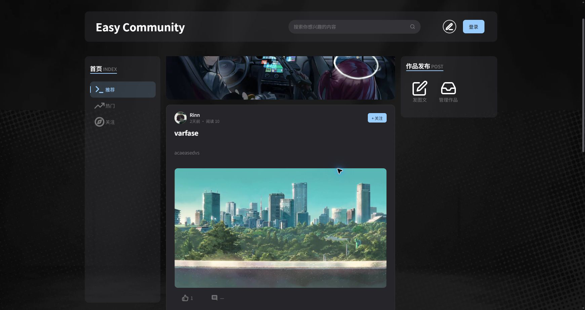
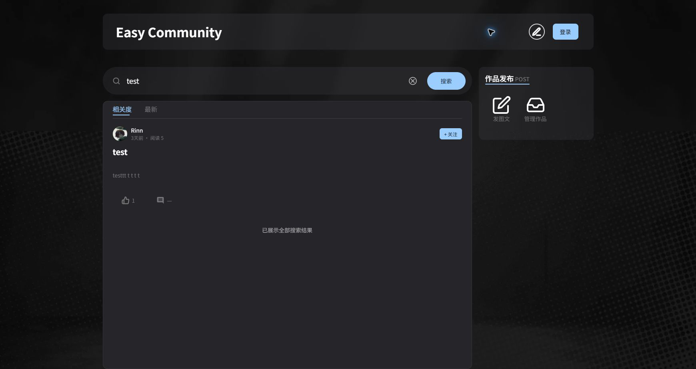
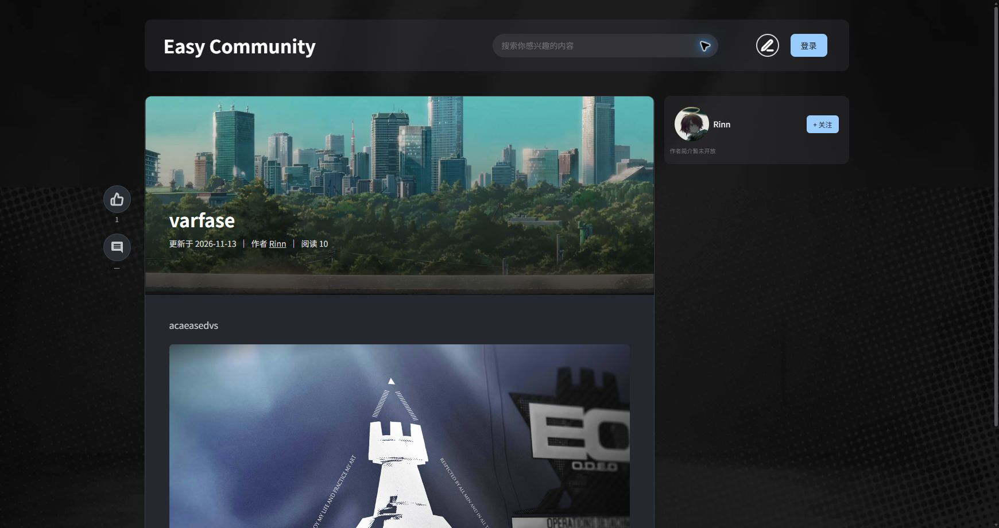
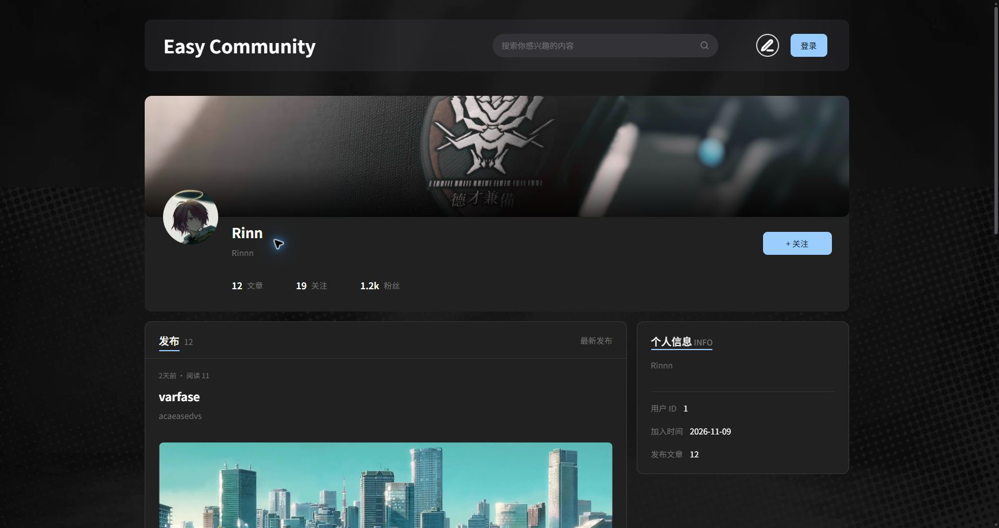
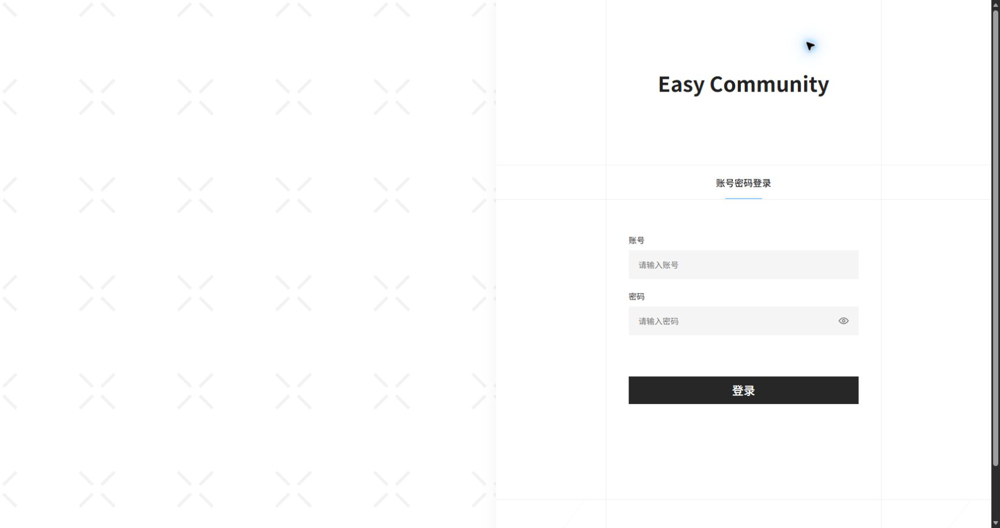
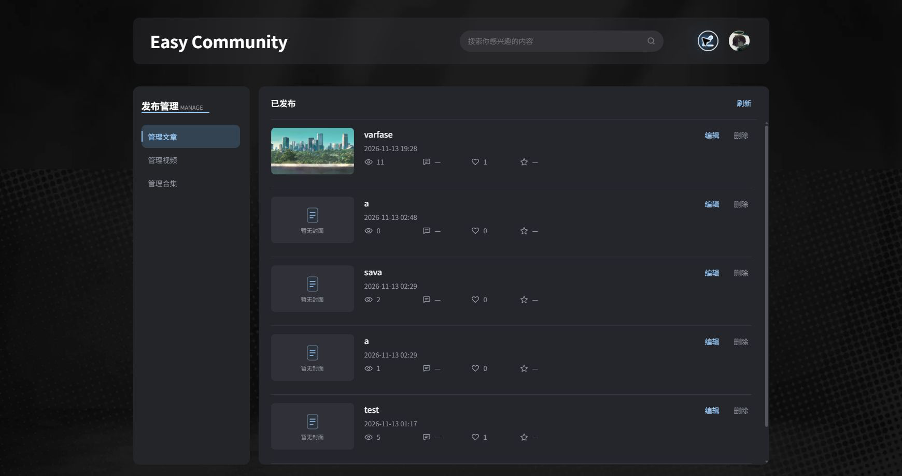
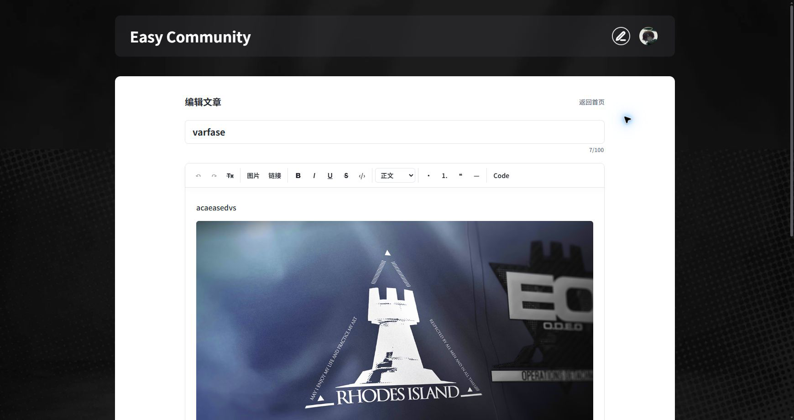
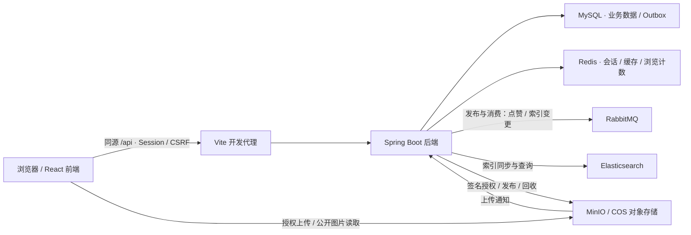

# Easy Community

<div align="center">

一个基于 **React + Spring Boot** 的前后端分离内容社区，由 [Easy Blog Full](https://github.com/Lancasteerr/Easy_blog_full) 演进而来，支持多用户、多角色、文章创作、标题搜索、推荐流、点赞和个人主页。


</div>

## 目录

- [项目简介](#项目简介)
- [功能特性](#功能特性)
- [项目展示](#项目展示)
- [技术栈](#技术栈)
- [快速开始](#快速开始)
- [项目结构](#项目结构)
- [系统架构](#系统架构)
- [当前边界](#当前边界)
- [相关文档](#相关文档)

## 项目简介

Easy Community 是一个内容交流社区。项目从个人博客扩展到多用户创作场景：访客可以浏览推荐文章、搜索标题和查看作者主页，登录用户可以发布、编辑、删除自己的文章，维护个人资料并参与点赞。

仓库包含 `fronted` 前端和 `backend` 后端。前端使用 React、TypeScript 与 Tiptap 构建浏览和创作体验；后端围绕认证、用户、文章与媒体划分业务模块，使用 MySQL 保存业务数据，Redis 承担会话、缓存和计数，RabbitMQ 与 Elasticsearch 支撑异步处理及文章查询。

## 功能特性

| 模块 | 功能 | 说明 |
| --- | --- | --- |
| 社区浏览 | 推荐信息流 | 游客可访问，支持游标续页；推荐排序结合近期浏览量与发布时间 |
| 社区浏览 | 文章详情 | 展示封面、正文、作者、浏览量与点赞；支持正文目录、代码高亮和阅读位置恢复 |
| 搜索 | 标题搜索 | 前端支持关键词、相关度与最新排序；后端另支持单标签和作者筛选 |
| 内容创作 | 文章管理 | 发布、编辑与删除本人文章，管理列表展示本人公开作品 |
| 内容创作 | 富文本编辑 | Tiptap 编辑器支持标题、列表、引用、链接、代码块、封面与正文图片 |
| 内容创作 | 文章标签 | 从已有标签目录选择，标签以文章 JSON 元数据保存 |
| 用户与权限 | Session 登录 | Spring Security + Redis Session，配合 CSRF 校验、登录限流与会话失效处理 |
| 用户与权限 | 多角色授权 | 后端定义 ADMIN、PATROLLER、USER 角色，按角色及资源归属控制操作权限 |
| 用户与权限 | 个人主页与资料 | 公开作者资料与作品列表，支持编辑个人简介和头像 |
| 互动统计 | 点赞与取消 | 登录用户可操作，RabbitMQ 异步落库，通过版本控制处理重复及乱序消息 |
| 互动统计 | 浏览量统计 | 公开文章详情读取时尝试计数，Redis 累计后定时写入 MySQL |
| 后端服务 | 公开读取缓存 | 文章内容、卡片和用户资料分别缓存，个人点赞状态独立追加 |
| 后端服务 | 可靠索引同步 | 文章变更通过事务 Outbox 与 RabbitMQ 同步至 Elasticsearch，支持索引重建和对账 |
| 媒体服务 | 图片直传与回收 | 支持 MinIO / COS，签名授权直传、通知发布、文件引用与无引用文件回收 |

## 项目展示

### 首页



### 文章搜索



### 文章详情



### 个人主页



### 登录



### 文章管理



### 文章编辑器



## 技术栈

| 层级 | 技术 |
| --- | --- |
| 前端框架 | React 19、TypeScript 7、React Router 7、Vite 8 |
| 样式与编辑器 | 原生 CSS、Tiptap 3、highlight.js / lowlight |
| 后端框架 | Java 25、Spring Boot 4.1.1、Spring Security、Spring Session |
| 数据访问 | MyBatis-Plus 3.5.17、MySQL 8、Flyway |
| 会话与缓存 | Spring Data Redis、Lua、定时任务 |
| 消息与搜索 | Spring AMQP、RabbitMQ、Elasticsearch Java Client |
| 文件存储 | MinIO（S3 协议）、腾讯云 COS |
| 验证与观测 | JUnit、Spring Boot Test、Vitest、Testing Library、Playwright、Actuator / Prometheus |
| 本地开发 | Maven、Node.js 24 LTS、npm、Docker |

## 快速开始

### 1. 环境要求

准备 JDK 25、Maven、Node.js 24 LTS 与 npm；本地依赖使用独立 Docker 容器运行。

### 2. 准备依赖

启动 MySQL、Redis、RabbitMQ、MinIO 和 Elasticsearch，创建空数据库 `easy_community`，连接信息以本机实际配置为准。首次使用还需准备媒体桶与 Webhook、消息拓扑、点赞签发器和搜索索引；应用启动不会自动完成这些初始化。

具体步骤见[后端说明](backend/README.md)、[媒体开发配置](infra/dev/media/README.md)、[Elasticsearch 启动说明](infra/dev/elasticsearch/README.md)、[点赞初始化与恢复](docs/public/operations/like/zh-CN/like-system-operations.md)及[搜索索引初始化](docs/public/operations/search/zh-CN/article-search-operations.md)。

### 3. 配置并启动后端

在仓库根目录执行，首次配置时复制开发模板：

```powershell
cd backend
# 已有 .env.dev 时保留原配置。
if (-not (Test-Path .env.dev)) { Copy-Item .env.dev.example .env.dev }
# 填写 .env.dev 中的连接信息、媒体参数与初始管理员凭证后，再执行下两行。
# 复制会覆盖已有 .env；已有可用配置时无需重复复制。
Copy-Item .env.dev .env
mvn spring-boot:run
```

应用只读取 `backend/.env`，由 `SPRING_PROFILES_ACTIVE=dev` 选择开发配置。首次启动由 Flyway 自动建表；开发模板开启首个管理员初始化，需要填写 `ADMIN_USERNAME` / `ADMIN_PASSWORD`，已有管理员时不会重置账号。也可使用 IDEA、JDK 25 直接运行 `BackendApplication`。

### 4. 启动前端

另开终端，从仓库根目录执行：

```powershell
cd fronted
# 首次配置时复制，并按本机 MinIO 地址与桶名修改。
if (-not (Test-Path .env.development.local)) { Copy-Item .env.development.example .env.development.local }
npm ci
npm run dev
```

访问 **http://127.0.0.1:5173/**。Vite 将 `/api` 代理到后端默认端口 `8080`；统一使用 `127.0.0.1`，避免与 `localhost` 混用导致 Cookie 分离。开发上传使用 `/__media/upload`，前端代理目标和桶名需与后端 MinIO 配置一致，详见[前端说明](fronted/README.md)。

## 项目结构

```text
easy_community
├─ fronted                       # React + TypeScript + Vite 前端（沿用现有目录名）
│  ├─ src
│  │  ├─ pages                   # 首页、搜索、阅读、管理与资料页面
│  │  ├─ components              # 导航、卡片等共享组件
│  │  ├─ api / auth              # 接口封装与会话边界
│  │  └─ article / editor / profile / search
│  ├─ dev                        # 本地媒体上传代理
│  └─ scripts                    # 真实联调脚本
├─ backend                       # Spring Boot 后端
│  ├─ src/main/java/com/febrie/backend
│  │  ├─ article                 # 文章、标签、浏览、点赞与搜索
│  │  ├─ auth / user             # 认证、会话、用户与角色
│  │  ├─ media                   # 上传授权、通知、引用与回收
│  │  └─ shared                  # 公共配置与基础能力
│  ├─ src/main/resources/db/migration
│  └─ src/test                   # 单元、集成与故障验证
├─ infra                         # 本地依赖配置与专项验证入口
└─ docs
   ├─ public                     # 当前架构、接入指南与运维说明
   ├─ development                # 设计过程与历史验收资料
   └─ screenshots                # README 真实页面截图
```

## 系统架构



MySQL 保存业务事实，Elasticsearch 是可重建的查询索引。文章提交与 Outbox 写入同一事务，异步同步索引；点赞经消息确认受理后异步落库。缓存、计数与索引更新存在短暂延迟，详细一致性约定见相关指南。本地 MinIO 上传响应由 Vite 开发代理适配。

## 当前边界

- **搜索范围**：当前检索文章标题，支持标签与作者条件；尚未实现正文检索和个性化推荐。前端搜索页目前仅开放关键词、相关度和最新排序。
- **功能入口**：评论、关注、收藏、独立热门页、视频及合集管理尚未开放，页面保留提示或占位；多角色权限不代表已有完整的管理员控制台。
- **个人统计**：个人主页的文章 `12`、关注 `19`、粉丝 `1.2k` 为样例值，与真实作品列表独立；作者资料、作品、浏览量和点赞接入真实接口。
- **页面适配**：主要页面采用 1440px 桌面画布，窄屏以横向浏览为主，移动端适配仍待完善。

## 相关文档

- [文档中心](docs/README.md) · [公开文档索引](docs/public/README.md)
- [前端说明](fronted/README.md) · [后端启动与认证约定](backend/README.md) · [基础设施索引](infra/README.md)
- [后端架构与模块职责](docs/public/architecture/backend/zh-CN/backend-architecture.md)
- [文章管理与缓存恢复](docs/public/guides/article/zh-CN/article-crud-implementation.md) · [文章标签](docs/public/guides/article/zh-CN/article-tags.md)
- [公开读取缓存](docs/public/guides/cache/zh-CN/public-read-cache.md) · [用户资料](docs/public/guides/user/zh-CN/user-profile.md)
- [标题搜索与推荐流](docs/public/operations/search/zh-CN/article-search-operations.md)
- [点赞接口与一致性约定](docs/public/guides/like/zh-CN/like-system-implementation.md)
- [图片上传与媒体生命周期](docs/public/guides/media/zh-CN/media-service.md)
