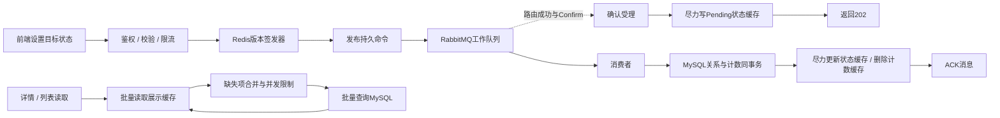
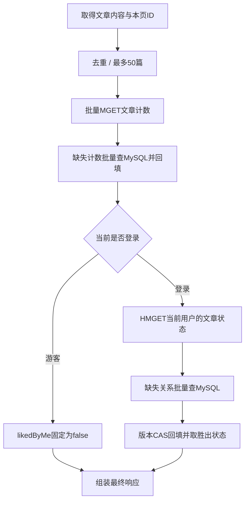

# 从一次点赞到可靠落库：社区系统点赞读写链路与一致性设计

> 文章策划与面试梳理稿，核对日期：2026-11-15。本文依据当前仓库代码梳理；测试与容量数字来自注明日期的历史报告，本次未重新运行测试或压测。后续可以沿用本文结构扩写正式文章。

## 1. 文章目的：展示如何把业务承诺落实到读写链路

这篇文章希望回答：当点赞需要保存用户与内容的关系，又面临频繁读取、连续操作、并发写入和依赖故障时，我如何确定数据的权威来源，划分一致性边界，并让系统在重复、乱序和故障后仍能得到可解释的结果。

面试展示的重点有四个：

1. 从业务语义出发建模：点赞是用户与文章的一条状态关系，点赞数是关系的聚合结果。
2. 根据承诺划分责任：MQ承接受理后的命令，MySQL保存当前关系与精确计数，Redis承担版本签发和展示缓存两种不同职责。
3. 解释正确性：用版本裁决处理乱序，用同事务净增量保证关系与计数一致，用提交后ACK允许消息安全重投。
4. 说明工程取舍：读写优化解决了哪些问题，哪些瓶颈仍然存在，如何通过故障测试和容量实验验证判断。

本文不以“用了多少中间件”作为亮点。每个组件都应对应一个明确问题，并能解释移除它或替换它后，系统承诺会怎样变化。

建议在开头使用下面这段话：

> 我把点赞建模为用户对文章的目标状态，使用服务端版本裁决最终结果。写接口在消息被可靠受理后返回202，由消费者将关系与计数放在同一个MySQL事务中更新。读接口通过批量缓存和受控回源降低数据库压力。这样可以在允许展示暂时滞后的前提下，保证重复、乱序消费不会把数据库里的关系和计数改错。

用词需要准确：当前实现是“用户—文章关系”；可以类比收藏、关注等状态型关系，但没有实现通用用户关系平台。

## 2. 先定义需求和一致性边界

### 2.1 业务要求

- 一名用户对一篇文章最多存在一个当前点赞状态。
- 用户可以点赞、取消点赞，也可以重复设置相同状态。
- 详情、推荐流、搜索及列表响应需要展示点赞数和当前访问者是否已点赞。
- 用户关系需要持久保存，不能只存在Redis中。
- 消息可能重复、乱序，应用可能在数据库提交后、消息ACK前崩溃。
- 受理后文章隐藏或账号注销，不撤销已经受理的命令；消费阶段沿用受理时确定的业务边界。

### 2.2 “一致性要求高”具体指什么

| 层次 | 当前承诺 | 适用边界 |
|---|---|---|
| 接口受理 | 路由成功且收到Broker正向确认后才返回202 | 202表示命令受理，不表示SQL已经提交 |
| 当前关系 | 同一关系只接受更高版本；相同版本和状态可重复消费 | 顺序定义为服务端版本签发顺序，不是客户端点击时间 |
| 数据库计数 | 当前关系变化与计数净增量在同一事务提交 | 精确对应已提交关系，不包含尚未消费的全部受理命令 |
| 页面展示 | 缓存、Pending投影和前端本地状态改善交互 | 允许暂时落后，不保证读己之写或跨字段同一快照 |
| 故障恢复 | 分配器异常时停签，数据完整的重启通过受控提升纪元恢复 | 不提供跨存储数据丢失、旧备份回滚的自动恢复 |

因此，文章适合表述为“数据库内关系与计数的事务一致性，加上异步处理与展示的最终收敛”。不能笼统宣称整个接口、MQ、MySQL和Redis实现了端到端强一致。

`likedByMe=true`而`likeCount`暂时仍为旧值，在当前接口契约下可能出现。关系和计数分别查询、分别缓存，响应不承诺它们来自同一个数据库快照。

## 3. 总体设计：三个提交阶段，两类Redis数据



Broker确认后先尝试Pending缓存，再返回202；Pending失败不会撤销已经成立的受理结果。消费者可能比Pending维护更早完成。

三个阶段分别是：消息受理、数据库提交、展示维护。它们有不同的成功条件，不能用“缓存更新失败”推翻数据库提交，也不能用“HTTP超时”推断消息一定没入队。

Redis中的数据要分开讨论：

- **版本签发器**：epoch、seq、guard，参与写入正确性，无TTL，异常时拒绝新写入。
- **展示缓存**：个人状态与文章计数，可以过期、丢失和回源，不是持久化事实来源。

“Redis只是缓存”只能用于描述展示数据，不能概括整个点赞模块。当前限流也依赖Redis；此外，登录态和文章内容链路仍可能有各自的Redis依赖。

## 4. 数据建模：关系是事实，计数是事务内聚合

| 表 | 关键字段 | 职责 |
|---|---|---|
| `article_like_state` | `(user_id, article_id)`联合主键，`liked`，`version`，`updated_at` | 保存当前状态及已处理最高版本 |
| `article_like_count` | `article_id`主键，`like_count` | 保存与关系同事务维护的精确计数 |
| `like_version_epoch` | 单行`epoch` | 为分配器故障恢复保留持久化纪元 |

在计数初始化正确、所有状态变更均经过该事务路径的前提下，需要维持的不变量是：

```text
某文章的 like_count = 该文章所有已提交关系中 liked=true 的数量
```

取消点赞仍保存`liked=false`及最高版本，这一行就是版本墓碑。例如取消命令v102先执行，旧点赞v101后到时，墓碑可以阻止旧命令把点赞恢复。直接删除关系行会同时丢掉这一裁决依据。

状态没有变化，但版本变大时，也必须推进最高版本。例如当前为已点赞v100，新命令是已点赞v103，仍需记录v103，否则中间取消v102迟到时可能被错误接受。

新建文章时在同一事务初始化零计数，迁移为已有文章补齐计数行。缺计数行属于不变量异常，不应在查询时自动伪造零；实际改变点赞数量时，也不能只提交关系更新。

当前只保存最终状态和最高版本，不保存每次点击历史。需要行为分析、逐操作审计时，应另行设计历史数据模型。

## 5. 写链路：从用户意图到可靠受理

### 5.1 使用设置状态接口

- `PUT /api/articles/{id}/like`：设置为点赞。
- `DELETE /api/articles/{id}/like`：设置为未点赞。
- 身份来自Session，沿用CSRF保护；客户端不能指定其他用户身份或自带权威版本。
- `X-Operation-Id`必须是UUID，用于追踪请求。

“设置为已点赞”能够反复执行；“反转当前状态”或“计数加一”在重试和乱序下更难解释。注意：目标状态操作可重复，不等于当前系统实现了HTTP请求去重。

### 5.2 入口步骤

1. 校验文章ID、operationId及登录身份。
2. 查询文章是否存在且公开。
3. 执行每用户固定窗口限流，默认每分钟60次，超限返回429及Retry-After。
4. 从Redis分配一个服务端版本。
5. 构造包含目标状态、关系标识、版本、操作标识及时间的命令。
6. 发布持久化消息，等待该次发送的Confirm，同时检查Return。
7. 确认受理后尽力写Pending状态缓存，返回202及目标状态和版本。

写入口仍包含认证、文章可见性等数据库读取。异步化的是点赞关系和计数的提交，不等于写请求完全不访问MySQL。

### 5.3 为什么Confirm与Return要同时处理

当前采用持久化Exchange、持久化消息、持久化Quorum工作队列，并开启mandatory和关联Confirm。不能把“客户端send方法返回”作为可靠受理证明；无路由的消息也不能返回202。

发布结果划分为：

| 情况 | 对外语义 |
|---|---|
| 在发送前因并发预算或预连接失败被拒绝 | 当前调用未开始发送，返回不可用 |
| Return明确表明无路由 | 发布被拒绝，不返回202 |
| 已开始发送后超时、断连或无法确认 | 结果未知，消息可能已被受理 |
| 已路由并收到正向Confirm | 返回202受理结果 |

未知结果不会触发后台无限重发。若客户端拿旧意图重新调用HTTP，会获得新版本，可能反过来覆盖用户后来提交的取消操作。

`operationId`目前不是去重键。同一个ID再次请求仍会重新分配版本；消息重复消费依靠原版本裁决。正式文章应主动说明这两个层次的区别。

## 6. 版本：不要求消费严格有序，要求最终裁决有序

当前版本结构为：

```text
version = (epoch << 43) | sequence
```

- epoch占20位，由MySQL持久化，受控恢复时推进。
- sequence占43位，在同一纪元由Redis Lua原子递增。
- 多个应用实例共享签发器；关系最终状态只比较属于该关系的版本。
- 完整版本通过HTTP和消息以十进制字符串传输。
- Redis状态缓存将版本补齐为19位字符串后比较，避免完整long经过Lua浮点数或JavaScript Number发生精度损失。

举例：用户连续设置点赞v101、取消v102，即使MQ先交付v102再交付v101，最终仍是取消v102。全局版本在实现上简化了多实例签发，但业务只需要同一关系内可比较；全局签发器也会带来集中依赖和可用性代价。

必须区分“较新版本”和“用户实际最后点击”。多设备并发、网络延迟和请求重发可能改变到达签发器的顺序；本方案不解决跨设备业务意图的严格时序。

## 7. 消费链路：关系、版本、净增量一次提交

消费者每次尝试调用独立事务代理，事务隔离级别为READ COMMITTED，事务内不访问Redis或MQ。

1. 使用无副作用的重复键更新确保关系行存在，初始为未点赞、版本0。
2. `SELECT ... FOR UPDATE`锁住该关系行。
3. 比较命令版本与数据库版本。
4. 对新版本更新关系，计算净增量并更新文章计数。
5. 事务代理正常返回后，才将结果视为SQL提交成功。
6. 尽力更新Committed状态缓存，并删除文章计数缓存。
7. 最后手动ACK消息。

版本裁决规则：

| 命令与现有记录的关系 | 处理 |
|---|---|
| 版本更小 | STALE，忽略，不使用旧命令重建缓存 |
| 版本相同、状态相同 | DUPLICATE，不再次改动计数 |
| 版本相同、状态不同 | 不变量冲突，隔离并排查 |
| 版本更大 | APPLIED，推进版本，按实际状态变化修改计数 |

净增量为：

```text
delta = 新状态对应的0或1 - 旧状态对应的0或1
```

| 原状态 | 新状态 | 计数增量 |
|---|---|---:|
| 未点赞 | 已点赞 | +1 |
| 已点赞 | 未点赞 | -1 |
| 已点赞 | 已点赞 | 0 |
| 未点赞 | 未点赞 | 0 |

SQL还校验计数不能下溢、更新行数符合预期。净增量非零时，计数缺行或更新异常会抛出异常，使关系更新一并回滚；净增量为零时不访问计数行，其缺失需由读取或对账发现。不同用户修改同一文章时，计数行更新仍由数据库行锁串行化；MQ没有消除这个热点。

可以用一个简短论证解释正确性：假设事务前计数等于所有关系状态之和，本次只改变一条关系，并给计数加上完全相同的状态差；两者原子提交后等式仍成立。重复和旧版本不改变两者，因此不会重复计数。

### 7.1 提交后ACK为何重要

- 提交前崩溃：事务回滚，消息未ACK，可重投。
- 提交后、ACK前崩溃：重投后发现相同版本与状态，不重复计数。
- SQL提交结果未知：不假定回滚，后续事务重新锁行、比较版本裁决。
- SQL提交后缓存维护失败：记录失败并继续ACK，展示依靠过期和后续查询修复。

这可以表述为“至少一次投递下，数据库状态变更具备幂等处理能力”，不能宣称消息只投递一次。

### 7.2 重试、死信与重放

暂时性SQL或事务异常在同次投递中最多尝试5次，退避为1、2、4、8秒。格式错误、不变量冲突以及重试耗尽进入死信处理。

工作队列配置at-least-once死信转发。不能先ACK原消息再自行发布死信，否则发布失败会留下消息丢失窗口。死信重放必须保留原版本和原始消息，在重新发布确认后再ACK原死信；重新编号会让历史命令变成新意图。

进入DLQ意味着该命令暂时没有完成处理；只有修复原因并恢复消费或重放后，才具备继续收敛的条件。

## 8. 读链路：共享内容与个人状态分开装配

详情、搜索、推荐和列表先取得文章内容，再在最终响应阶段追加`likeCount`和`likedByMe`，不把个人状态写进共享文章缓存。



计数缺失项通过一次`IN`查询读取，当前用户的关系缺失项通过另一次`IN`查询读取。没有并发请求交叠导致批次拆分的普通场景，一批最多50篇文章使用至多两条点赞回源SQL；全命中则不需要点赞回源SQL。该数量不包含认证、文章内容或阅读计数等其他模块查询，也不是所有并发批次的全局SQL数量上界。

游客不查询个人关系。MySQL不存在某条用户关系时，才可解释为未点赞、版本0；计数行缺失、数据库错误或超时不能解释成“点赞数为0”。

### 8.1 缓存失效时保护数据库

`BatchReadGate`在单实例内按Key共享在途Future，并将本请求新承担的缺失项合并查询。计数按文章ID合并，状态按用户与文章关系合并。

- 每实例默认最多4个在途回源任务，计数与状态共享预算。
- 每次回源等待预算默认300ms，超时或过载返回503。
- 单个等待者超时不取消其他请求仍在共享的任务。
- SQL结果取得后先释放回源名额，再执行缓存回填，避免慢Redis长期占用SQL回源额度。

300ms是一次回源等待预算，不是整个HTTP接口的总延迟上界；两个阶段及其他依赖耗时仍需单独观察。共享在途工作只在本实例内生效，没有分布式互斥。

点赞展示缓存不可用时可回源SQL，但认证和内容链路仍有各自依赖，因此不能由此推导出“Redis宕机后整个网站仍可正常工作”。

## 9. 缓存一致性：用版本减少覆盖，用固定TTL修复残留

### 9.1 个人状态缓存

每个用户一个Hash，文章ID作为Field，值包含19位版本、状态及阶段：

- P：消息受理后的Pending展示。
- C：数据库提交结果或SQL查询结果。

Lua对写入执行CAS：高版本优先；同版本同状态时C可以替换P；旧版本不能覆盖新版本；同版本异状态报错。查询回填时返回CAS胜出的状态，减少“旧SQL读取结果覆盖新Pending”的问题。

Hash固定600秒过期，只在首次创建时设置TTL，其他Field更新和重复回调都不续期。这里是整个用户Hash的寿命，不是每条关系独立600秒。

Hash丢失或过期后，旧回调可能在空缓存中重新写入较旧状态。CAS只能比较当前仍然存在的版本，不能证明缓存永远单调。因此这只是改善展示的一致性措施，不能代替数据库裁决。

### 9.2 文章计数缓存

计数只从SQL填充，使用`SET NX EX 30`；提交后删除缓存，不对展示缓存执行INCR/DECR，也不将缓存计数刷回数据库。

这样减少了重试、重复消息引起缓存与SQL分别累加的风险，但仍有“读旧值—写事务提交并删缓存—旧读回填”的竞态。NX不能阻止旧读在空Key上回填，只能避免覆盖已有Key；固定TTL限制该次旧填充的存活时间。

600秒和30秒都只描述单次缓存生命周期。MQ积压、迟到进程回调或未修复DLQ会延迟后续状态，不能据此承诺全链路一定在对应秒数内一致。

## 10. 前端实际行为：受理后更新展示

当前`useArticleLike.ts`按以下策略处理：

- 同一个Hook在途期间拒绝再次提交，按钮也处于busy禁用状态。
- 收到匹配operationId的受理响应后，更新本地liked和显示计数。
- 切换文章、用户或离开页面时，使用生命周期与generation检查避免旧回调修改新页面。
- 已尝试写入但结果未知时保留当前展示，不自动重复发送；后续由用户刷新重新读取。

本地计数按自身状态差调整，因此不会代表全站其他用户此刻的精确计数；受理响应中的liked也是受理目标，不是SQL提交证明。

现有接入指南仍描述“点击立即乐观更新、快速切换合并为最终目标”，与当前代码不一致。正式文章应使用上面的实际行为；如果未来采用乐观更新，需要补充在途意图合并、未知结果提示及旧响应处理的完整交互设计。本次梳理不修改前端实现。

## 11. 分配器故障恢复：宁可暂停签发，也不重用版本

单纯对Redis执行INCR只能解释正常运行。若重启或恢复旧持久化数据后序号被重用，不同命令可能得到相同版本，或者新意图落在旧版本之后。

当前Lua在签发时检查epoch、seq、guard是否完整匹配、是否无TTL、状态是否READY，以及guard绑定的Redis运行标识是否仍等于当前run_id。异常时拒签；即使AOF中Key完整，只要Redis进程重启导致run_id变化，也需要恢复。

数据完整的故障恢复流程：

1. 关闭外部入口并停止所有业务实例，隔离可能继续签发的旧端点。
2. 维护命令取得专用MySQL连接命名锁，检查expectedEpoch。
3. 在MySQL持久提交epoch+1。
4. 在Redis以新epoch初始化seq=0和绑定当前run_id的PAUSED guard。
5. 再次核验持锁与SQL纪元，条件激活READY。
6. 启动业务实例，核验后人工开放入口。

普通应用重启不会提升纪元。恢复途中若SQL纪元已提交、Redis初始化失败，下次必须从当前SQL纪元继续提升，允许空洞，不能在可能用过的纪元里归零。

不能根据关系表最大版本恢复签发上界，因为未落库命令可能仍在MQ中，未知发布结果也可能已经入队。对于MySQL或MQ数据丢失、旧备份回滚，现有维护工具没有自动恢复承诺。

这体现了明确取舍：展示缓存可以尽力服务；参与正确性的签发器不确定时，需要牺牲新写可用性。

## 12. 为什么这样选，以及哪些需求下应换方案

| 方案 | 适合的需求 | 与当前方案的取舍 |
|---|---|---|
| 同步MySQL短事务，加查询缓存 | 流量可承受，要求成功响应时关系已持久化 | 更简单，值得作为起点；当前没有与其进行公平基准对比 |
| Redis先维护关系和计数，异步刷库 | 能接受明确的数据恢复或丢失边界，并有可靠补偿设计 | 持久化关系、重试去重和故障回滚需要额外证明，当前没有采用 |
| MQ先可靠受理，再事务落库 | 可接受202及异步展示，需要缓冲突发并处理重复和乱序 | 引入Broker、积压、未知结果及人工运维成本，是当前选择 |
| 业务事务与Outbox同库提交 | 同步业务状态变化还必须可靠发出后续事件 | 当前入口不同时写关系SQL和发布消息，未采用；未来增加事务后事件需重新评估 |

当前没有Outbox，并非已经解决了任意跨存储双写。它通过改变写入口的成功条件，让命令先进入MQ，再由消费者提交关系；数据库提交与ACK之间依靠版本幂等处理。

MQ主要提供缓冲和处理解耦，不会无限提高数据库持续吞吐。入口长期大于消费能力时仍会积压，必须限流或拒绝新发布。当前没有证明它比同步事务方案有更高持续吞吐，不应把异步化本身写成性能结论。

## 13. 现有证据：正确性、故障和容量分别说明

### 13.1 正确性与故障验证

仓库已有真实MySQL、Redis、RabbitMQ集成测试，以及应用进程崩溃和依赖重启测试，覆盖的关键场景包括：

- 同关系乱序、重复、同版本冲突、同状态新版本推进、取消墓碑。
- 多关系竞争同一文章计数，计数缺行回滚。
- SQL提交后ACK丢失及进程硬退出，再投递不重复计数。
- 无路由不能返回202，发布未知保留未知语义。
- DLQ不可用时消息保留，重放保留版本。
- Redis重启后拒签、恢复纪元、恢复竞争和迟到维护拒绝。
- 缓存CAS、固定TTL、旧消息不重建缓存、批量查询和回源预算。

2026-11-06报告记录一次完整后端回归共224项，211通过、13跳过，零失败与错误。其中13项为真实对象存储测试12项和容量实验1项；224不是“点赞模块的224个测试”。本次只核对了代码和报告，没有重新执行这些测试。

### 13.2 容量实验要区分受理和落库

2026-11-05本机双应用、共4消费者、每阶段30秒的历史实验显示：

| 场景 | 实际请求QPS | HTTP P95 | 阶段末已受理待提交数 |
|---|---:|---:|---:|
| 均匀写，目标120 QPS | 119.89 | 53.86ms | 1 |
| 均匀写，目标240 QPS | 236.88 | 51.22ms | 1055 |
| 单文章热点写，目标120 QPS | 119.86 | 48.02ms | 2 |
| 单文章热点写，目标240 QPS | 239.63 | 40.90ms | 162 |

240 QPS时HTTP仍可快速返回，但后台已经积压；这说明只看202成功率和入口延迟会高估系统能力。最终实验完成后的SQL对账一致，是正确性证据，不等于过程中没有延迟。

实验使用共享开发机，MySQL目录为tmpfs，不能代表生产持久磁盘和长期容量。120 QPS也只能表述为该短窗口内待提交量基本稳定，不能宣称为生产SLA、容量上限或当前版本复测结论。

上线观察至少应包含入口延迟、Confirm结果、消费TPS、已受理到提交的耗时、队列深度与年龄、DLQ、数据库锁等待、缓存命中与回源拒绝。消费时采样的消息年龄不能冒充整个队列最老消息年龄，指标标签也不应使用用户或文章ID。

## 14. 需要主动说明的局限与改进方向

1. **先证明复杂度必要。** 当前社区规模是否值得引入全局签发器、MQ及人工纪元恢复，需要业务目标、同步方案基线和故障要求支撑。文章可以把它定位为一次明确探索一致性和可靠性的工程实践。
2. **热点计数行仍是瓶颈。** 增加消费者不一定提高吞吐，反而可能增加锁竞争。计数分片或异步聚合会改变读成本和精确性承诺，应在实测证明需要时再设计。
3. **单节点依赖没有节点级容灾。** 单节点Quorum不等于高可用；当前也没有完整的Redis高可用切换协议。复制、故障切换和持久化策略必须与签发边界一起验证。
4. **没有HTTP级请求幂等和严格读己之写。** 如业务要求超时后查询确定结果，可考虑持久化操作状态与查询协议；如要求成功即落库，应首先评估同步事务。不能只加一张去重表就认为跨存储问题已解决。
5. **墓碑会持续增长。** 当前没有在线物理清理协议。清理前必须证明所有旧消息、死信、备份和迟到请求不会再生效，还要考虑注销与数据保留策略。
6. **索引与查询能力有限。** 联合主键适合按用户批量查文章状态，当前没有专门支持文章反向查询的索引；“谁赞过这篇文章”和高频全量对账需要另外评估。
7. **未知结果交互仍可改进。** 当前保留展示、等待用户刷新较简单，但用户不容易理解。后续可以增加清晰的待确认提示，是否需要操作状态查询则取决于产品要求。
8. **文档需要跟随实现。** 前端当前行为与接入指南存在差异；正式发布文章前应统一，避免面试时依据旧设计描述已移除的能力。

## 15. 推荐正式文章结构与讲述节奏

正式正文建议保持一篇文章完成闭环：

1. 用“点赞、取消乱序到达”引出问题，给出业务目标和一致性承诺。
2. 给出全链路图，说明受理、落库、展示三个不同阶段。
3. 解释关系模型、墓碑、版本和净增量，给出乱序与重复的具体例子。
4. 沿一次写请求讲到Confirm、SQL事务、ACK，再补充未知结果和故障恢复。
5. 沿一次列表读取讲批量缓存、个人状态隔离、受控回源及缓存过期边界。
6. 使用历史故障测试和积压数据验证方案，最后交代适用条件与设计代价。

正文不宜展开所有运维参数。版本位数、Lua比较和纪元恢复可作为深入阅读部分；面试主线优先让听众理解为什么每个环节存在。

### 两分钟讲述稿

> 我做的是社区文章点赞，首先把它定义为用户对文章的当前关系，而不是一个简单的加一接口。接口使用PUT和DELETE设置目标状态，由服务端签发版本，消息被RabbitMQ确认受理后返回202。
>
> 消费者不依赖严格有序投递，而是在MySQL事务中锁住关系、比较版本，只应用更高版本。取消时保留版本墓碑，防止旧点赞迟到后把状态恢复。关系变更和计数净增量在同一事务提交，所以重复消息和乱序消息都不会重复计数；提交后才ACK，崩溃重投也能安全处理。
>
> 读取时先取共享文章内容，再按当前用户批量装配点赞数和个人状态，最多50篇的普通批次最多两条点赞回源SQL，同时通过实例内请求合并和并发预算保护数据库。缓存主要改善展示，我没有把它当成数据库的权威事实。
>
> 这套方案的边界是异步受理，不保证成功响应时已经落库，也不保证刷新立即读到自己的操作。Redis版本签发器故障会暂停新写并通过纪元恢复。历史压测中240 QPS虽然仍能快速返回202，但后台已经积压，这也让我把入口延迟和最终提交能力分开衡量。

### 常见追问的回答要点

| 面试追问 | 回答要点 |
|---|---|
| 为什么不直接操作Redis计数？ | 需要持久化关系，且重复、乱序和恢复需要统一裁决；当前以MySQL事务为事实依据 |
| 为什么取消不删除记录？ | 保留最高版本，挡住迟到的旧点赞；同时承认墓碑增长成本 |
| 幂等靠什么？ | 原消息重投靠关系版本；operationId仅追踪，HTTP重发会签发新版本 |
| SQL提交后ACK丢失怎么办？ | 重投后同版本同状态不重复计数 |
| 为什么不保证MQ顺序？ | 多消费者和重投仍需考虑乱序，状态型命令可以按最高版本收敛 |
| HTTP超时是不是失败？ | 发送后可能已入队，属于未知，不能自动重发过时意图 |
| 缓存CAS是否保证强一致？ | 不能，缓存丢失后比较依据也丢失；固定TTL只是修复机制的一部分 |
| 是否一定需要MQ？ | 不一定，同步短事务更简单；需要基于突发缓冲、受理语义和实测选择 |
| 为什么没有Outbox？ | 当前入口先发命令，没有同步关系SQL与发消息的双写；新增提交后事件时重新评估 |
| 确认消息后是否永远不会丢？ | 承诺依赖Broker持久数据完整等故障模型，当前单节点不覆盖磁盘丢失和跨存储回滚 |
| 为什么240 QPS不算系统容量？ | 当时HTTP受理成功但待提交量增长，入口吞吐不等于稳定处理能力 |

## 16. 代码与证据入口

| 主题 | 当前仓库入口 |
|---|---|
| HTTP协议与写编排 | [LikeController](../../../../backend/src/main/java/com/febrie/backend/article/like/web/LikeController.java)、[LikeWriteService](../../../../backend/src/main/java/com/febrie/backend/article/like/application/LikeWriteService.java) |
| 可靠发布、消费与拓扑 | [LikePublisher](../../../../backend/src/main/java/com/febrie/backend/article/like/infrastructure/messaging/LikePublisher.java)、[LikeConsumer](../../../../backend/src/main/java/com/febrie/backend/article/like/infrastructure/messaging/LikeConsumer.java)、[LikeRabbitConfiguration](../../../../backend/src/main/java/com/febrie/backend/article/like/infrastructure/messaging/LikeRabbitConfiguration.java) |
| SQL裁决与表结构 | [LikeSqlService](../../../../backend/src/main/java/com/febrie/backend/article/like/application/LikeSqlService.java)、[LikeMapper.xml](../../../../backend/src/main/resources/mapper/main/article/like/LikeMapper.xml)、[V5迁移](../../../../backend/src/main/resources/db/migration/V5__create_article_like.sql) |
| 版本与恢复 | [LikeVersion](../../../../backend/src/main/java/com/febrie/backend/article/like/domain/LikeVersion.java)、[签发Lua](../../../../backend/src/main/resources/redis/like-version.lua)、[LikeRecoveryService](../../../../backend/src/main/java/com/febrie/backend/article/like/application/maintenance/LikeRecoveryService.java) |
| 批量读取与回源 | [LikeQueryService](../../../../backend/src/main/java/com/febrie/backend/article/like/application/LikeQueryService.java)、[LikeReader](../../../../backend/src/main/java/com/febrie/backend/article/like/application/LikeReader.java)、[BatchReadGate](../../../../backend/src/main/java/com/febrie/backend/article/like/application/BatchReadGate.java) |
| 缓存投影 | [LikeCache](../../../../backend/src/main/java/com/febrie/backend/article/like/infrastructure/redis/LikeCache.java)、[状态CAS](../../../../backend/src/main/resources/redis/like-state.lua)、[计数回填](../../../../backend/src/main/resources/redis/like-count-fill.lua) |
| 响应装配与前端 | [详情装配](../../../../backend/src/main/java/com/febrie/backend/article/content/web/response/ArticleDetailResponseAssembler.java)、[列表装配](../../../../backend/src/main/java/com/febrie/backend/article/search/web/ArticleSearchAssembler.java)、[useArticleLike](../../../../fronted/src/article/useArticleLike.ts) |
| 历史验证与容量 | [2026-11-06验证记录](../../reports/like/like-validation-2026-11-06.md)、[2026-11-05容量报告](../../reports/like/like-capacity-2026-11-05.md)、[原始JSON](../../reports/like/like-capacity-2026-11-05.json) |
| 当前协议与维护前提 | [接入指南](../../../public/guides/like/zh-CN/like-system-implementation.md)、[运维手册](../../../public/operations/like/zh-CN/like-system-operations.md) |
