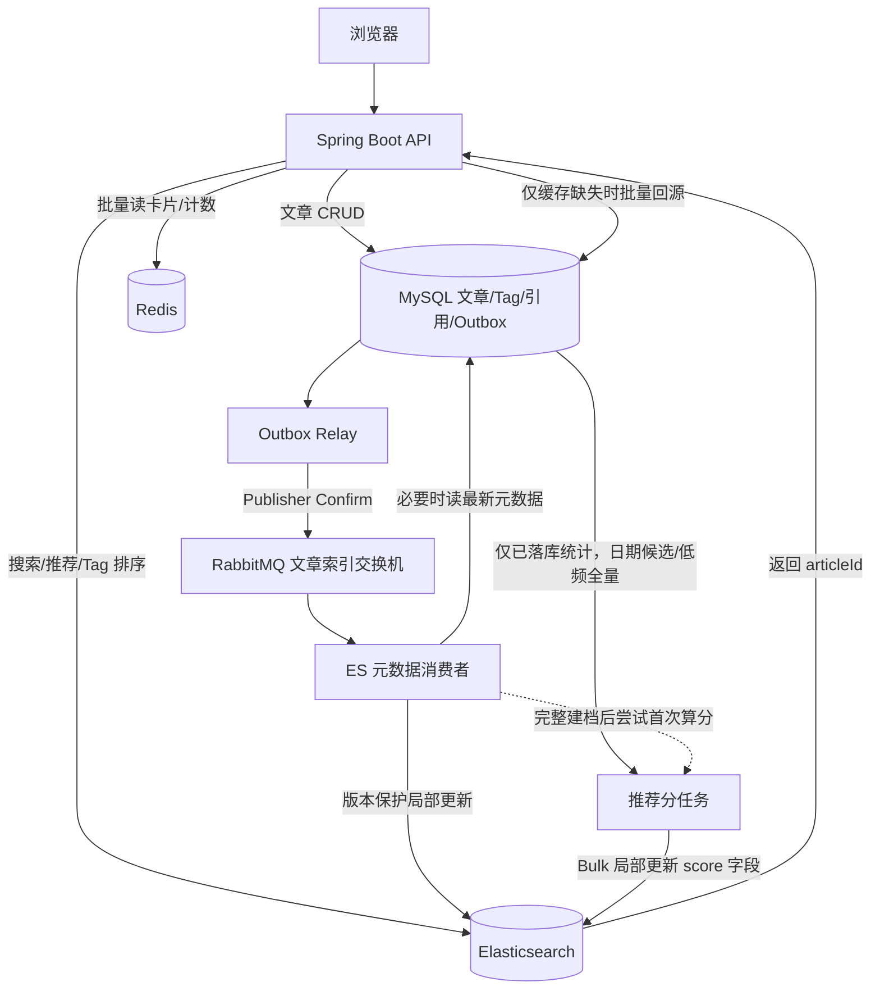
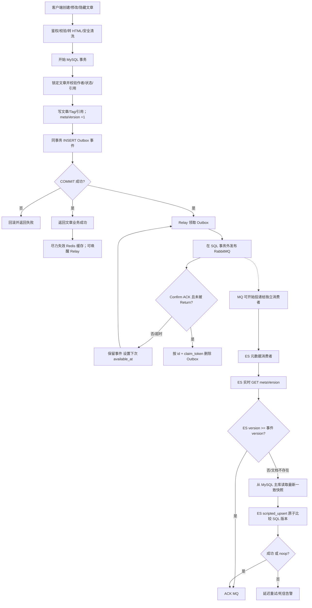
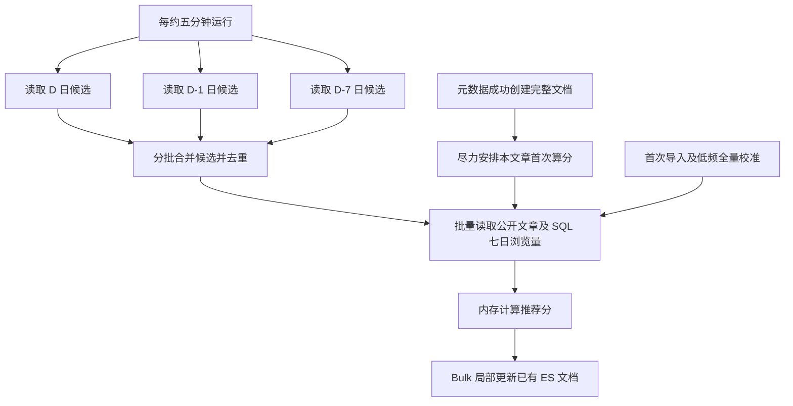
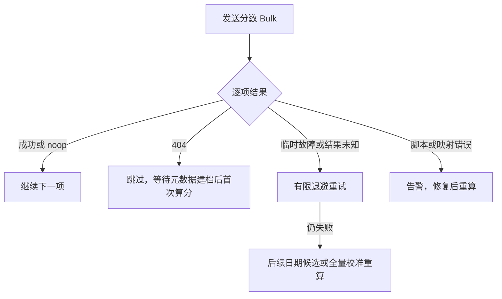
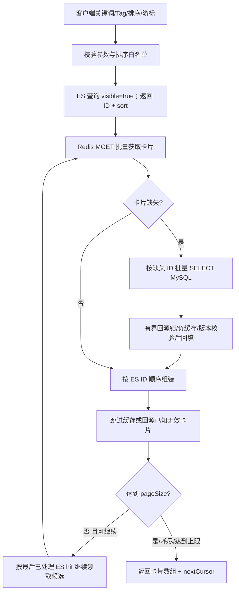
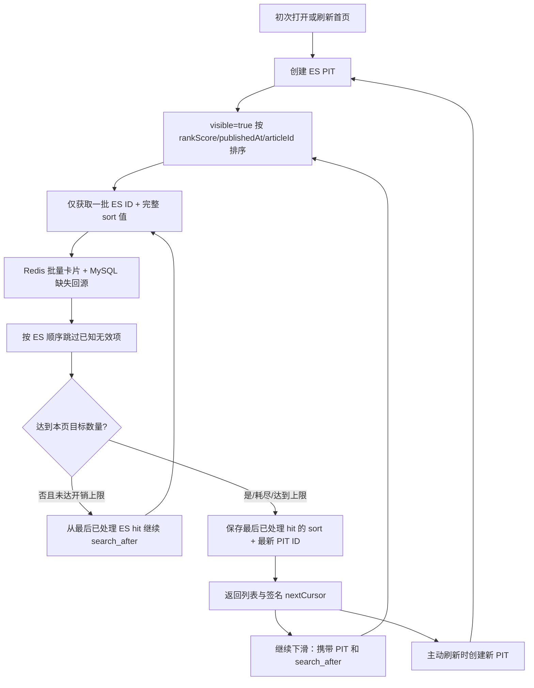
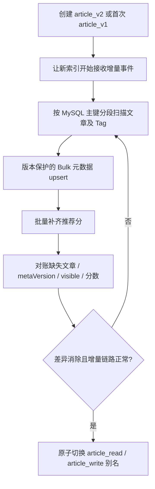

# 社区系统 ES 接入与可靠索引同步 —— Codex 交接文档

> 状态：已按本次讨论修订，待实施。本文是目标设计，不声称项目中相关代码已完成。
> 目标：以最小必要复杂度接入 Elasticsearch，保留 MySQL + Redis + RabbitMQ 现有架构。
> 2026-11-08 修订：仅交付后端；推荐分采用“日期候选 + 建档首次算分 + 低频全量校准”，取消点赞因子、Redis 统计合并及严格统计批次排序。

## 0. 最终决策摘要

1. **Elasticsearch 只负责搜索、筛选、排序与返回 articleId**；列表卡片由 Redis 批量读取，缺失时 MySQL 批量回源；正文 HTML / TipTap JSON 不入 ES。
2. **文章元数据与推荐分在同一个 ES 文档，但分开更新、分开版本控制**：`metaVersion` 严格对应 SQL 文章变更，`scoreVersion` 使用计算任务开始时间戳粗略防旧，允许相近时间统计结果覆盖，不建立持久批次序号。
3. **文章新增、修改、隐藏使用事务 Outbox**：同一 MySQL 事务写文章及 Outbox；SQL 提交即表示业务成功；Relay 后续向 RabbitMQ 至少一次可靠投递。无需跨 MySQL / RabbitMQ 分布式事务。
4. **ES 元数据消费者先实时 GET 版本**；若 ES `metaVersion >= event.metaVersion`，直接 ACK；否则读取 MySQL **主库的最新一致元数据**，再用 ES **原子条件脚本**更新。这是性能预过滤，不是并发安全的替代。
5. **简化 Outbox**：成功投递即删除；无需 `status` / `retry_count` / `delivered_at`。保留 `id`、`article_id`、`meta_version`、`available_at`、`claim_token`，可选 `created_at`（建议保留便于监控）。
6. **推荐分只使用 SQL 已落库浏览量与发布时间**。每约五分钟分批计算 D、D-1、D-7 三个统计日期的候选文章；建档时初始化零浏览基线并尝试首次算分；首次导入及低频校准才扫描全部公开文章。不走每次阅读/点赞的消息，不引入排名锁或任务状态表。
7. **搜索/全局信息流都走 ES → ID → Redis/MySQL**；无限滚动用 PIT + `search_after`，按最后一个**已处理候选**推进游标。
8. **SQL 是权威数据，ES 是可重建派生索引**。隐藏文章在 ES 中设 `visible=false`，保留墓碑及 `metaVersion`，不要物理删除后让迟到的旧消息复活文章。

## 1. 范围与一致性边界

- 已有：文章 CRUD、文件引用事务、文章缓存/回源锁/负缓存、浏览量统计、点赞系统、RabbitMQ。
- 本次仅实现后端：标题搜索、Tag 精确筛选及排序、全局推荐信息流接口、可靠 ES 元数据同步、推荐分刷新、索引初始化及故障恢复；不实现前端逻辑。
- 不做：正文全文检索、个性化推荐、每次点赞直接更新 ES、ES 作为权威数据源、Kafka / Redis Streams / Debezium。
- **强事务**：文章元数据、Tag、媒体引用和 Outbox 插入在一个 MySQL 事务；**最终一致**：SQL→MQ→ES、统计→ES、SQL→Redis 缓存失效。
- 接受少量陈旧或失效卡片：查询过滤 ES visible，装配时跳过缓存墓碑或回源已确认无效的项；不逐篇/逐批额外查询主库状态。后端承诺最终收敛，不承诺隐藏立即不可见，也不把客户端处理作为后端验收条件。

## 2. 总体架构



**RabbitMQ 文章索引消费者独立队列**，不要与点赞等既有消费者竞争消费同一队列。使用专用索引 Exchange / Routing Key 并核验目标绑定；`mandatory` 只证明消息至少路由到某个队列，不证明一定到了 ES 队列。缓存失效保持尽力执行和 TTL 兜底，首版不新增可靠缓存队列，也不把 Redis 成功设为 ES 消费 ACK 的前提。

## 3. 数据结构

### 3.1 ES 索引

索引 `article_v1`，读别名 `article_read`，写别名 `article_write`；单个文章 `_id = String.valueOf(articleId)`。保留 `_source` 以供脚本更新；查询结果设置 `_source: false`，只取 `_id` 和 `sort`。

推荐 Mapping（示例，具体分片/副本按部署资源调整）：

```json
PUT /article_v1
{
  "mappings": {
    "dynamic": "strict",
    "properties": {
      "articleId":      {"type":"long"},
      "title":          {"type":"text", "analyzer":"cjk"},
      "summary":        {"type":"text", "index":false},
      "authorId":       {"type":"long"},
      "tags":           {"type":"keyword"},
      "publishedAt":    {"type":"date"},
      "visible":        {"type":"boolean"},
      "metaVersion":    {"type":"long"},
      "rankScore":      {"type":"double"},
      "viewCountTotal": {"type":"long"},
      "scoreVersion":   {"type":"long"}
    }
  }
}
```

- `title` 只做标题搜索。先用 ES 内置 `cjk` 分词器，确实需要中文精细分词时再评估 IK/ICU 插件兼容性；用 `_analyze` 和真实中文技术标题做测试。
- `tags` 为稳定的 Tag ID/slug（`keyword`）；若使用可改名的 Tag 名称，改名时须触发受影响文章索引更新。
- `summary` 按需求保留在 ES 的 `_source`，但不参与搜索。若没有任何索引用途，可删除该字段以精简。
- `viewCountTotal` 只在确实需要 Tag 页面“按累计浏览量”排序时保留，并与推荐分在同一统计版本更新；若只需 `rankScore` 排序可以去掉。
- 推荐分/累计浏览数允许数分钟延迟，实时数值仍由 Redis 供卡片展示。`authorId` 不存昵称；正文、HTML、文件引用、用户点赞状态不进索引。
- 当前项目没有草稿/待发布状态，`visible = !hidden`；所有检索查询必须过滤 `visible=true`。

文档示例：

```json
{
  "articleId": 10001,
  "title": "Spring Boot 缓存优化实践",
  "summary": "介绍 Redis 回源锁与缓存优化",
  "authorId": 123,
  "tags": ["java", "redis"],
  "publishedAt": "2026-11-01T10:00:00Z",
  "visible": true,
  "metaVersion": 8,
  "rankScore": 85.6,
  "viewCountTotal": 12000,
  "scoreVersion": 1794000000000
}
```

### 3.2 MySQL 文章版本

```sql
ALTER TABLE article
  ADD COLUMN meta_version BIGINT NOT NULL DEFAULT 1;
```

- 已有老数据初始化为 `1`；新文章创建从 `1` 开始，后续每次改变 ES 相关元数据或可见性 `+1`。
- 更新文章行时在 SQL 中原子递增版本，不能由 Spring 读旧值后自行 `+1` 再无条件覆盖。
- Tag 关系修改须与文章版本递增处于**同一事务**。文章锁和权限校验复用现有设计；允许“最后一次成功提交覆盖前次编辑”，版本仍须单调。
- 编辑成功后在事务内准确取得新版本（按实际 ORM/JDBC 写法设计），并同步写 Outbox。
- 软删除/隐藏保留 SQL 行与版本；如果以后允许真正物理删除，必须新增版本化墓碑或明确的删除事件协议，不能直接用本文的“SQL 回源最新行”逻辑。

### 3.3 最小而支持多 Relay 的 Outbox

```sql
CREATE TABLE article_outbox (
    id           BIGINT PRIMARY KEY AUTO_INCREMENT,
    article_id   BIGINT NOT NULL,
    meta_version BIGINT NOT NULL,
    available_at DATETIME(3) NOT NULL DEFAULT CURRENT_TIMESTAMP(3),
    claim_token  BINARY(16) NULL,
    created_at   DATETIME(3) NOT NULL DEFAULT CURRENT_TIMESTAMP(3),
    KEY idx_available (available_at, id)
) ENGINE=InnoDB;
```

- `id`：唯一事件 ID，也可作为消息 `eventId`。
- `article_id`、`meta_version`：给消费者执行版本预检查；不保存文章完整内容。
- `available_at`：未领取/失败时是“下次重试时间”，领取中是“租约到期时间”。统一入口条件 `available_at <= NOW(3)`。
- `claim_token`：每次领取生成新的随机 UUID（以 16 字节存储），用于防止旧 Relay 的迟到 Confirm 删除新 Relay 已重新领取的事件。
- `created_at`：可选但推荐保留；用于监控最老未投递消息年龄。**不需要 `status`、`retry_count`、`delivered_at`**。
- 成功确认路由且 Broker 持久接收后直接 `DELETE`；失败保留行并推迟 `available_at`。即使偶发重复投递，消费者也幂等。
- 不建议 `article_id` 设唯一键后覆盖旧 Outbox：会引入 Relay 领取、更新和删除间的竞态。保持一条业务变更对应一条不可变事件，可靠性更直观。

## 4. 文章新增 / 修改 / 隐藏链路



### 4.1 业务事务边界

1. 非 SQL 的 HTML 转换、内容安全过滤、外部资源检查等尽量放到事务外；SQL 事务内保证最终状态、Tag/引用与版本一致。
2. 创建文章先通过 SQL INSERT 得到新 `articleId`，再创建 Tag/引用、Outbox；修改/隐藏则锁定并更新现有文章。
3. `INSERT article_outbox(article_id, meta_version) VALUES (?, ?)` 与文章数据操作在同一个 `@Transactional` 事务中。
4. **事务成功即可以向客户端返回成功**；MQ、ES 不参与用户请求的提交条件。可在响应里说明搜索可见稍有延迟，不要宣称立刻入索引。
5. 提交后的本地回调只负责尽力失效缓存、唤醒 Relay，不能取代 Outbox。Redis 缓存失效失败由 TTL 兜底，允许短暂旧卡片，不阻塞索引同步。

### 4.2 Relay 领取 / 重试（无持久状态机）

定时任务（示例 0.5～2 秒，可配置）在短事务中：

```sql
START TRANSACTION;

SELECT id, article_id, meta_version
FROM article_outbox
WHERE available_at <= NOW(3)
ORDER BY available_at, id
LIMIT 100
FOR UPDATE SKIP LOCKED;

-- 对被选中 ID 批量 UPDATE：
-- available_at = NOW(3) + INTERVAL 30 SECOND
-- claim_token = 本轮领取 UUID（二进制）

COMMIT;
```

- `FOR UPDATE SKIP LOCKED` 的锁只在**领取事务**中持有。更新租约后立即 COMMIT，再进行 RabbitMQ 网络投递。千万不要持有 MySQL 行锁等待 Confirm；在需要时可将领取事务隔离级别单独设为 `READ COMMITTED`，减少范围锁影响。
- 可让每个领取批次共享一个随机 `claim_token`，但删除/失败更新必须同时匹配 `id AND claim_token`；也可每行单独 token。
- RabbitMQ 发布：持久化交换机/队列、持久化消息、Publisher Confirm、`mandatory=true`、处理 Return；使用专用路由或校验目标 ES 队列绑定；**Confirm ACK 且未发生不可路由 Return 才认为投递成功**。Confirm ACK 不代表 ES 处理完成。
- 成功：`DELETE FROM article_outbox WHERE id=? AND claim_token=?`。
- NACK / Return / 超时：`UPDATE article_outbox SET available_at=?, claim_token=NULL WHERE id=? AND claim_token=?`，设置固定退避 + 抖动（如 5～15 秒）；无需 `retry_count` 也能实现可靠重试。想做指数退避再引入尝试计数字段，不是现在必须。
- 进程宕机：领取后的租约到期，`available_at` 变为可领取，其他实例自动重试；消息可能重复，但不应丢。
- 确保 MQ 的 Confirm 超时短于租约时长；若长批次超过租约，续约或缩小批次，避免大量重复发送。旧 Relay 迟到也不能凭过期 token 删除新 Relay 领取的行。
- 必须限制每次领取量、在途 Confirm 数和 Relay 并发；监控最老 `created_at`、未投递行数。长期不成功时告警而不是无限高频敲打 SQL/MQ。
- 若使用 MySQL 复制，注意 `SKIP LOCKED` 不适用于 statement-based replication；优先使用 row-based binlog。

### 4.3 消费者：先检查 ES 版本，再回源 SQL

MQ 消息：

```json
{"eventId":90001,"articleId":10001,"metaVersion":9}
```

伪代码：

```java
void consume(ArticleIndexChanged e) {
    // Elasticsearch GET，realtime=true，仅获取 metaVersion
    EsMetaState state = es.getMetaVersion(e.articleId());
    if (state.exists() && state.metaVersion() >= e.metaVersion()) {
        ack();  // 重复或过期通知：不查询 SQL，不更新 ES
        return;
    }

    // 必须来自 MySQL 主库；读文章及 Tag 要形成一致快照
    ArticleMetaSnapshot snapshot = sql.loadCurrentArticleMeta(e.articleId());
    if (snapshot == null || snapshot.metaVersion() < e.metaVersion()) {
        retryAndAlert();  // 不要 ACK 或随意忽略
        return;
    }

    // ES 内再次原子比较版本，防止 GET 与 UPDATE 之间发生并发写入
    EsUpdateResult result = es.scriptedUpsertMeta(snapshot);
    if (result.successOrNoop()) {
        ack();
        // 仅完整建档成功后尽力投递一次算分；入口有界且内部隔离异常，不影响已完成的元数据确认。
        if (result.created() && snapshot.visible()) rank.tryScheduleFirstCalculation(snapshot.articleId());
    } else retryWithBackoff();
}
```

为什么两次检查：

- 前置 GET **只是一项性能优化**，用来跳过迟到、重复的消息；它增加一次 ES GET，所以需要评估重复率、节省的 SQL 次数和 ES 延迟。
- `GET -> SQL -> UPDATE` 存在 TOCTOU 竞态，例如 A 读 SQL v6，B 读 SQL v7 并先写 ES，A 随后写入 v6。**只有 ES Update API 内部的原子版本判断才能阻止回退**。
- 使用 `scripted_upsert=true`，文档不存在时创建所有元数据字段，并用 `rankScore=λ*(publishedAtHours-fixedEpochHours)` 初始化零浏览基线，`scoreVersion=0`、`viewCountTotal=0`；已存在时只更新元数据字段，绝不覆盖推荐分字段。首次真实算分读取 SQL 七日统计，见第 5 节。
- 比较规则：`incoming SQL snapshot.metaVersion > ES.metaVersion` 才赋值，否则 `ctx.op='noop'`。`retry_on_conflict` 处理内部写冲突；异常不应 ACK。
- 不要混淆 `metaVersion`（业务版本）与 ES 内部 `_version` 或 `_seq_no`。前者才是跨 SQL/MQ/ES 的版本依据。
- 多 SQL 查询组装 Tag 关系时，要保证单一一致快照（例如 MySQL 主库短只读 RR 事务或等价的一致读取）。绝不能使用可能滞后的从库，否则可能读出版本低于消息版本的数据。
- 文章只软删除：隐藏事件从 SQL 回源仍能得到 `visible=false` 和更高版本。若全文索引数据缺失且对应 SQL 行真实物理删除，不能靠本文方案自行恢复。
- MQ 消费者在 ES 写成功、或确定事件已经过时后才手动 ACK；临时错误延迟重试；持续错误进入 DLQ 并告警/人工恢复。不要无限立即 `requeue=true` 形成忙循环。

ES 端脚本逻辑（伪代码，Codex 按所选 ES Java 客户端转换为 Painless 参数化脚本）：

```text
if (ctx.op == 'create') {
    初始化 articleId、metaVersion=0、rankScore=incoming.initialRankScore、scoreVersion=0、viewCountTotal=0;
}
if (incoming.metaVersion > stored.metaVersion) {
    仅赋值 title、summary、authorId、tags、publishedAt、visible、metaVersion;
} else {
    ctx.op = 'noop';
}
```

> initialRankScore 由后端按第 5 节公式和快照 publishedAt 计算，仅创建分支使用。注意脚本创建分支、JSON/Painless 数字类型、缺失字段、`ctx.op='noop'` 的兼容性；需要编写真实集成测试，不应仅凭上述伪代码上生产。

### 4.4 重复 / 乱序的期望行为

| 输入情况 | 预期动作 |
|---|---|
| ES metaVersion=11，消息 v8 | GET 后直接 ACK，无 SQL |
| ES metaVersion=11，消息 v11 | GET 后直接 ACK，无 SQL |
| ES metaVersion=8，消息 v9，SQL 已到 v11 | 回源 SQL v11，尝试直接写 ES v11 |
| A 读 SQL v9，B 写入 ES v11，A 后完成 | A 在 ES 原子脚本中 noop，不允许倒退 |
| ES 文档不存在，消息 v4，SQL v6 | 创建完整元数据文档 v6，初始化零浏览时间基线，再尽力触发首次算分 |
| SQL 成功但 MQ 停机 | Outbox 保留，Relay 持续温和重试 |
| RabbitMQ Confirm 丢失 | Outbox 重发，消费者幂等 |
| ES 成功、消费者 ACK 丢失 | MQ 重投，GET 比较后 ACK |
| 缓存/ES 尚未收到隐藏通知 | 允许少量陈旧卡片，依靠索引同步及缓存 TTL 最终收敛 |

## 5. 推荐分更新链路（日期候选 + 建档首次算分 + 低频校准）

### 5.1 数据来源与公式

浏览请求只负责累计计数；已有后台任务约每分钟把 Redis 日累计的差值写入 MySQL。排名任务独立读取 **SQL 已落库数据**，不触发或等待刷盘，不合并 Redis 累计桶，也不向 ES 投递每次浏览消息。现有 ArticleViewService.record 尚未发现被详情 HTTP 链路调用，实施时须补上公开详情成功取得后的计数入口；列表读取不计数，计数故障不阻断正文返回。

固定本轮业务日 D，沿用 Asia/Shanghai；窗口为今天及前六个业务自然日，不是精确滚动 168 小时：

```text
view7d = SUM(article_view_stat.pv)，stat_date ∈ [D-6, D]
rankScore = log1p(view7d) + λ * (publishedAtHours - fixedEpochHours)
```

λ 非负、fixedEpoch 固定，跨实例配置一致；编辑不刷新首次发布时间。**取消所有点赞因子，也不使用累计点赞替代。** 没有日统计记录按零浏览计算，SQL 查询失败不能当作零浏览。若 Tag 热门需要累计浏览排序，同批读取 article.view_count 并更新 viewCountTotal，它不额外加入推荐分公式。

发布时间项是常量，因此只有浏览增加、日桶滑出、新建档或公式调整需要更新分数；不需要每五分钟扫描所有冷文章，更不需要每秒重算。

### 5.2 常规任务如何选择计算范围

固定一个实例启用调度，每轮结束后间隔约五分钟再运行；不增加分布式任务锁。每轮读取三组候选：

| 统计日期 | 候选用途 |
|---|---|
| D | 覆盖今天已落库浏览的变化 |
| D-1 | 覆盖现有刷盘任务对昨天的补写 |
| D-7 | 覆盖刚滑出七日窗口的日桶，使旧热度下降 |

例如 D 为 11 月 8 日：读取 11 月 8 日、7 日、1 日的候选 ID，再计算它们在 11 月 2～8 日的实际浏览量。**D-7 只用于选候选，不计入七日热度。** 一天内每轮都读取 D-7，不维护“午夜是否处理成功”的持久进度。

现有日表主键是 `(article_id, stat_date)`，另增加日期候选索引：

```sql
-- 原主键继续服务单批文章的七日聚合；新索引服务按日期选候选。
CREATE INDEX idx_article_view_stat_date_article
    ON article_view_stat (stat_date, article_id);
```

三个日期各自按 article_id 做有界主键式分页，利用 `(stat_date, article_id)` 索引连续扫描；分批合并候选并去重，再批量读取仍公开的文章及七日日桶。示例每批最多 500 篇，不查正文、不逐篇 SELECT、不加 FOR UPDATE。批间少量重复计算可以接受，不为全轮去重持有无界 ID 集合。单批 SQL 结束后在内存计算并请求 ES，不用长事务包住扫描或网络等待。

这依赖当前刷盘只补今天和昨天；将来如果新增更早日期的历史修复，修复入口应额外尝试重算受影响 ID，遗漏仍由低频全量校准恢复。若多数文章每天都有浏览，候选可能仍接近全站，届时再考虑“刷盘后记录真正变更 ID”的优化，首版不增加 Redis 待算集合。



### 5.3 建档初始化、版本与首次算分

元数据创建分支初始化 `rankScore=λ*(publishedAtHours-fixedEpochHours)`，即零浏览情况下的时间基线，`scoreVersion=0`。无浏览文章此后无需周期更新；普通元数据编辑不能重置已有分数。

成功创建完整公开文档后，ACK 元数据消息并尽力安排一次真实算分，批量入口也支持单个 ID。该入口使用有界执行能力，不要求可靠本地队列，排队失败/进程退出不反向影响已成功的元数据同步；有浏览的文章可被日期候选再次覆盖，其余由低频全量校准补上。不能继续假设“所有文章每五分钟必定再次扫描”。

`scoreVersion` 使用本次计算任务开始时的毫秒时间戳；ES 脚本比较 `incoming.scoreVersion > stored.scoreVersion`，仅修改 rankScore、viewCountTotal（需要时）和 scoreVersion。它只是粗略防旧，不代表严格统计水位；相近时间结果覆盖可接受，不引入 SQL 持久批次计数器或统计读取锁。每次 Bulk 重试沿用本次参数，有限重试后交给后续重算，不长期堆积旧计算结果。

### 5.4 ES 同步迟到与失败恢复

**分数更新禁止 upsert。** ES 文档尚未建档时返回 404，记录数量并跳过；元数据建档后尝试首次算分，不能创建缺少状态的半文档。Bulk 即使整体请求成功，也逐项检查 updated、noop、404、冲突、429、5xx；临时错误或结果未知有界退避重试，永久脚本/映射错误记录并告警。



### 5.5 低频全量校准及性能边界

首次上线必须在元数据导入后对全部公开文章算一次分；此后保留低频全量校准，例如每天一次。按文章主键和本轮最大 ID 分段、限速，复用同一算分与 Bulk 逻辑；公式参数修改、长时间任务停机后也执行一次全量校准。不要求在线双写排名，不建排名任务状态表。

如果某文章的 D-7 候选当天写 ES 一直失败，第二天它可能已退出三日候选；如果首次算分触发丢失，也不一定再进入常规候选。**这些遗漏依靠低频全量校准恢复，不承诺下一轮五分钟任务全部修正。** 校准自身失败时，下次从头按主键分段重跑，监控最近一次完整成功时间和失败项数量即可。

正常情况下扫描成本随三天的有浏览文章数增长；低频校准仍是 O(公开文章数)，但不再每五分钟执行。排名读取不增加文章行锁；现有整日浏览刷盘写事务的锁竞争另行观察，不在本次顺带重构。Redis 未落库浏览量因丢失或日桶过期而损失属于已有统计精度边界，ES 重建无法还原，首版接受。

## 6. 标题搜索 / Tag 搜索链路



- 标题搜索：`match(title, query)`；Tag 筛选：`term(tags, stableTag)`；都必须有 `term(visible,true)`。
- 有标题关键词时：按 `_score DESC, publishedAt DESC, articleId DESC`；纯 Tag 最新：`publishedAt DESC, articleId DESC`；Tag 热门：按 `viewCountTotal DESC, publishedAt DESC, articleId DESC`（前提是已经在 ES 维护该字段），或明确改成推荐分排序。
- ES `_source:false` 返回 `_id` 和 `sort`，不要返回文章 HTML/JSON；用 Redis `MGET` 获取卡片缓存、批量 SQL `WHERE id IN (...)` 回填缺失值，再按 ES ID 顺序重排。SQL `IN` 结果顺序不保证正确。
- 文章卡片所需的最新浏览量、点赞量以及当前用户点赞状态从各自 Redis/业务批量读取，不把用户特定状态存 ES。
- 沿用现有回源锁/负缓存/TTL/删除标记，但批量回源必须有并发限制；不要每个缺失 ID 单独请求 SQL，也不要在请求线程无界等待锁。
- 仅过滤缓存墓碑/负缓存或回源已确认无效的项，不额外批查主库状态；允许少量陈旧卡片。有界补充候选，达到预算时允许短页；尚未耗尽可返回空 items 和非空 nextCursor，不为凑齐页大小无限补查。
- 关键词长度、Tag 数量、pageSize、查询耗时、最大补齐轮次均设上限；排序字段白名单，不允许客户端任意构造 ES DSL。

## 7. 全局推荐信息流 / 无限滚动



ES 查询核心结构（实际请求还应附带 PIT / `search_after`；使用 PIT 时请求路径不指定索引）：

```json
{
  "_source": false,
  "size": 30,
  "track_total_hits": false,
  "query": {"term": {"visible": true}},
  "sort": [
    {"rankScore": "desc"},
    {"publishedAt": "desc"},
    {"articleId": "desc"}
  ]
}
```

- PIT 保证本轮滚动的索引视图不随新文章和推荐分变化而跳动；`search_after` 负责深度游标分页。首次创建 PIT，后续使用 ES 最新返回的 PIT ID 和**完整 `sort` 数组**（可能包含 PIT 隐式 `_shard_doc`）。
- 接口返回不透明 `nextCursor`，服务端包含并验证查询指纹、PIT ID、sort、过期时间；防止将 Tag/关键词游标混用。按需要签名或服务端保存；PIT 过期返回可识别错误，不在后端静默换 PIT 拼接旧游标。
- 每页 ES 可能预取 30 条但只消耗前 23 条就获得 20 篇有效卡片：游标必须取**第 23 条已处理的 hit**，不能取第 30 条，否则遗漏 24～30 条。被过滤的已处理 hit 也算游标已经经过。
- 一个 PIT 内稳定遍历候选；实时隐藏的文章仍可能在旧 PIT 中，仅按缓存/回源已知状态尽力过滤，接受少量陈旧项，不新增权威状态查询。新文章只有创建新 PIT 后才进入新浏览会话。
- 控制 PIT `keep_alive` 和活跃数量；完成时尽可能关闭。ES 不可用时可有限降级到已经生成的首页缓存，不能无界退回 SQL 深分页把主库打爆。

## 8. 初次导入 / 重建 / 对账



- **重要：已投递成功的 Outbox 行被删除，它不是长期事件日志，不能假设可以用 Outbox 重放历史。**
- 首次上线可先启动 MQ 索引消费者，再执行 SQL 全量分段导入，使用与正常消费一致的 `metaVersion` 条件 upsert 防止导入快照覆盖较新的事件结果；导入期间所有新变更仍须进入新索引。
- 首版 v1→v2 采用维护窗口：停文章写入并排空/暂停在途索引及排名工作，回填元数据、全量算分、刷新对账后原子切换读写别名，再恢复服务。将来若做无停机重建，需另设计新旧目标双写；不能只切别名后假设回填期间的修改已经同步。
- 全量导入也不允许无条件 `index` 覆盖新版本，不能用零浏览基线重置已有推荐分。首次导入对全部公开文章独立算分，之后使用日期候选和低频全量校准。
- 对账按 articleId 范围分段、控制速率：SQL 有而 ES 没有；版本/可见性不符；隐藏文章仍可检索；ES 无 SQL 对应有效文章；分数长期未更新；Outbox 最老事件年龄和 MQ DLQ 数量。
- 业务数据以 MySQL 为准，必要时整索引重建；切换前先验证最新变更能抵达新索引。索引别名切换使用 `_aliases` 原子操作。

## 9. 故障与边界矩阵

| 故障 / 边界 | 预期处理 |
|---|---|
| SQL 事务失败 | 文章/Tag/引用/Outbox 全部回滚 |
| SQL 提交后 Spring 宕机 | Outbox 仍在，定时 Relay 后续投递 |
| RabbitMQ 不可用/不可路由 | 未满足 Confirm+Route；Outbox 不删，按 available_at 重试 |
| Relay 已发送，确认丢失 | 可能重复投递，消费者版本判断幂等 |
| Relay 已领取后宕机 | 租约到期重新领取；旧 Relay 无法删除新租约 |
| ES 写失败、MQ 仍在 | MQ 延迟重试，超限 DLQ 告警并修复后重放 |
| ES GET 已查 v5、另一消费者抢先写 v7 | 脚本原子比较，迟到 v6 noop |
| score 批次晚于/早于元数据更新 | 各自只改本组字段与本组版本，不覆盖另一组；允许近时分数覆盖 |
| score 更新时 ES 文章不存在 | 不 upsert；跳过后由建档首次算分、日期候选或低频全量校准补算 |
| 建档首次算分触发失败或进程退出 | 保留零浏览基线，日期候选覆盖不到的由低频全量校准补回，不阻塞元数据 ACK |
| D-7 候选因失败直到次日仍未算分 | 可能退出常规候选，由低频全量校准修正 |
| 午夜切换或今天/昨天浏览延迟落库 | 每轮固定 D；持续扫描 D、D-1、D-7，接受近时覆盖，不增加午夜任务状态 |
| 历史统计修复超出今天/昨天 | 修复入口额外尝试重算受影响 ID，遗漏由全量校准恢复 |
| SQL 主从复制延迟 | 索引消费者只读主库，不从从库取旧快照 |
| ES 索引比 SQL 更新慢 | 搜索结果暂时滞后；系统最终同步 |
| Redis 缓存命中已隐藏文章 | 已知隐藏则跳过，否则接受少量陈旧卡片，缓存 TTL 兜底 |
| PIT 存在期间文章隐藏 | 旧 PIT 仍可能返回该 ID，按已知状态尽力过滤并有界补齐 |
| PIT 过期 | 返回可识别错误、重新开启浏览会话 |
| SQL/Redis 统计部分落盘 | 排名只读 SQL 已落库值，不合并 Redis；允许刷盘和排名延迟 |
| 排名 SQL 读取失败或 Bulk 部分失败 | SQL 错误不伪装零浏览；有限重试，遗漏由后续候选或全量校准恢复 |
| Outbox 事件长期堆积 | 控制扫描/投递并发，告警积压年龄；不无限放大 SQL 压力 |

## 10. 实施建议（Codex 工作顺序）

1. **先审阅现有代码**：确认 MySQL 版本、文章与 Tag 表结构、文章事务边界、缓存 TTL、RabbitMQ 配置、浏览计数入口及今天/昨天刷盘范围；禁止直接凭示例表名改动。
2. **ES 单节点开发环境**：容器部署、认证与网络配置；验证 Java 客户端与服务器版本匹配；创建 Mapping、读写别名，验证中文标题 `cjk` 分词与 Tag 查询。
3. **SQL 变更**：文章 `meta_version`（含老数据迁移）；建最小 Outbox 六字段表；确保新增/修改/隐藏同事务插入 Outbox。写事务测试。
4. **Relay**：短事务 `SKIP LOCKED` 领取 + 令牌租约；事务外 RabbitMQ Publisher Confirm/mandatory Return；成功按令牌删除，失败修改时间；定时扫描兜底；增加积压指标。
5. **MQ→ES 消费者**：实时 GET 版本预检查、主库一致快照、条件 scripted_upsert，手动 ACK、延迟重试/DLQ；创建分支初始化零浏览时间基线，成功后尽力安排首次算分。实现版本竞态与重复消息测试。
6. **卡片回填公共组件**：实现 ES ID 列表→Redis MGET→MySQL IN 批量回源→有序合并/可见性过滤，重用回源锁/负缓存。避免 N+1 SQL。
7. **标题和 Tag 搜索**：分页、排序白名单、缓存回填、返回游标；先上线有限规模验证。
8. **推荐分批量任务**：接通详情浏览计数；增加 `(stat_date, article_id)` 索引；实现 D/D-1/D-7 分批候选、SQL 七日聚合、建档首次算分、时间戳 scoreVersion、Bulk 分项处理及低频全量校准。验证 Meta/Score 字段隔离，不加持久批次表或统计锁。
9. **首页全局信息流**：PIT + `search_after`；正确推进最后已处理候选游标；刷新重建 PIT；有界补齐已隐藏项。
10. **初始化 / 重建 / 演练**：版本保护导入后全量算分；验证维护窗口重建、别名切换及故障恢复，再开放后端检索/信息流接口。当前仓库没有旧 Redis 全局排名或前端迁移任务。

## 11. 最低验收清单

- [ ] SQL 提交成功且 Spring 立即崩溃，文章事件仍能投递到 ES。
- [ ] Outbox 多实例同时领取，不会失去事件；MQ 故障恢复后不丢事件。
- [ ] MQ 已收到消息但 Confirm 丢失，重复投递不修改已更新 ES 文档。
- [ ] ES v10 收到消息 v8：不访问 SQL，直接 ACK。
- [ ] ES v8 收到消息 v9，SQL 已 v11：最终 ES 元数据为 v11。
- [ ] 两消费者交错：较旧 SQL 快照最后写入不能覆盖较新 ES 版本。
- [ ] 元数据更新和推荐分更新并发，不会覆盖彼此字段。
- [ ] Tag 修改、文章隐藏都递增元数据版本并可靠投递。
- [ ] 首次创建文档包含可见性及元数据，分数为零浏览时间基线；score 更新不会产生半文档，后续元数据编辑不会重置分数。
- [ ] D 为 11 月 8 日时，候选覆盖 8 日、7 日、1 日，热度只累计 2～8 日；过期日桶文章能降分，昨天补写能生效。
- [ ] 日期候选按 `(stat_date, article_id)` 分批读取；冷文章不因常规排名遍历 article 全表，不逐篇 SQL 回源、不加排名读取锁。
- [ ] ES 建档晚于算分返回 404 后，建档首次算分能更新该文档；首次触发丢失、候选日退出及长时间停机的遗漏能由低频全量校准修复。
- [ ] 相近时间分数覆盖允许发生；Bulk 部分失败有界重试，SQL 故障不写入伪造零浏览；不读取点赞或叠加 Redis 累计桶。
- [ ] Redis 大量 miss 时没有逐条 SQL 回源；列表 ID 顺序与 ES 完全一致。
- [ ] PIT 期间推荐分变化，不导致同轮候选重复；预取未消费的 ID 不被游标跳过。
- [ ] 缓存/回源已知无效项被跳过；热命中不额外查主库状态；允许少量陈旧卡片，空页、结束及游标过期由后端响应明确区分。
- [ ] ES 暂停、重启和索引重建后，能通过投递重试、批量导入及对账收敛。
- [ ] RabbitMQ DLQ、Outbox 最老事件、ES 写入错误率和批量回填 SQL 压力有可用监控。

## 12. Codex 需重点复核的实现点

1. 仓库真实的 MySQL / RabbitMQ / Spring 依赖版本和 Java 客户端 API，特别是 Confirm+Return 回调的关联处理，不能把 Broker ACK 当作消费者成功。
2. ES GET 预检查的实际成本：基于消息重复率对比“先 GET 再 SQL”与“直接 SQL+条件更新”，保留开关；**无论如何保留原子条件更新**。
3. MySQL 一致快照：Article + Tag 从主库读取时是否能读到混合版本。
4. `scripted_upsert` 的创建/更新分支及 `retry_on_conflict`；ES `_source` 开启，数字字段类型和默认字段完整。
5. Outbox 领取租约与确认超时的匹配；数据库时间而非各机器本地时间用于计算租约。
6. 复用现有 token 锁、墓碑和 TTL 防旧回填；缓存维护保持尽力执行，不因追求立即可见性新增主库状态检查或阻塞 ES ACK。
7. 日期候选索引与分批查询、D-7 选候选但不计热度、今天/昨天刷盘前提、首次算分及低频校准的补偿边界；不虚构点赞日统计或合并 Redis 累计桶。
8. 重建新索引期间持续变化的文章，不能以无条件 Bulk Index 或早已清理的 Outbox 历史记录充当增量来源。
9. ES、Redis、MQ 或 MySQL 局部故障时必须有速率限制和超时策略，不能为了追求缓存命中率无限冲击 SQL。

## 参考官方文档

- Elasticsearch Update API（scripted_upsert、noop、局部更新）：https://www.elastic.co/docs/reference/elasticsearch/rest-apis/update-document
- Elasticsearch Realtime Get：https://www.elastic.co/docs/api/doc/elasticsearch/operation/operation-get-source
- Elasticsearch Search After 与 PIT：https://www.elastic.co/docs/reference/elasticsearch/rest-apis/paginate-search-results
- Elasticsearch 内置 CJK 分词器：https://www.elastic.co/docs/reference/text-analysis/analysis-lang-analyzer
- Elasticsearch Alias 切换：https://www.elastic.co/docs/manage-data/data-store/aliases
- MySQL SKIP LOCKED：https://dev.mysql.com/doc/refman/8.4/en/innodb-locking-reads.html
- RabbitMQ Publisher Confirm：https://www.rabbitmq.com/docs/confirms
- RabbitMQ mandatory Return：https://www.rabbitmq.com/docs/publishers

**落地原则：MySQL 负责业务真相；Outbox 负责 SQL→MQ 可靠交接；MQ 负责异步消费可靠性；ES 负责可重建的检索排序视图；Redis + MySQL 负责最终展示数据。优先把故障恢复与版本竞态做正确，不为简单的标题/Tag 搜索引入额外中间件。**
