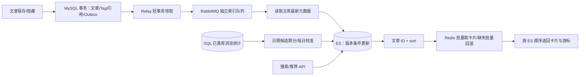

# ES 接入、搜索与全局推荐流 v1 计划

> 2026-11-08｜设计与实施计划，尚未实现。
>
> 以[ES 接入与可靠索引同步交接文档](../../handoffs/search/社区系统_ES接入与可靠索引同步_Codex交接文档.md)为基线，结合当前 master 代码收敛。本次只编写计划；交接文档中的命令、示例与实施步骤作为设计参考。
>
> [分享对话](https://chatgpt.com/share/6aef562b-b85c-83ee-9e99-0c0a9ac38894)当前只能取得预览页，未能读取对话正文；本计划不声称已核对完整对话。旧 ES 审阅稿中的严格排名批次、可靠缓存队列和展示前主库状态检查，不纳入本计划；原交接文档保留。

## 1. v1 交付范围

交付后端：标题搜索、单 Tag 精确筛选、最新/推荐排序、全局推荐流，以及支持这些功能的可靠索引同步、批量卡片装配和索引初始化/恢复。继续使用 MySQL、Redis、RabbitMQ，只新增 Elasticsearch。

| 能力 | v1 决策 |
|---|---|
| 搜索 | 只搜标题，先用内置 `cjk`；支持关键词与单个 Tag 组合 |
| 排序 | 有关键词默认相关度；无关键词默认最新；支持最新和推荐排序 |
| 全局推荐 | 所有人共享同一候选排序；七日浏览量与首次发布时间算分 |
| 列表展示 | ES 返回 ID 和 sort，Redis 批量取卡片，缺失时 MySQL 批量回源 |
| 一致性 | 业务事务可靠提交，索引最终一致；允许数分钟排名延迟及少量陈旧卡片 |
| 分页 | 搜索与推荐共用 PIT + search_after，不返回精确总数 |
| 故障 | ES 不可用时检索接口返回 503；文章保存仍以 SQL 事务结果为准 |

“热门”统一解释为推荐分排序，暂不提供累计浏览量排序，因此 ES 不需要 `viewCountTotal`。卡片仍可展示实时浏览量和点赞信息。这个取舍减少一组索引数据维护，也避免同一版本出现两个含义接近的热门入口。

明确后置：正文搜索、联想/纠错/高亮、中文分词插件、多 Tag 组合、作者筛选、个性化、关注流、多路召回、点赞参与排名、刷量治理、可靠缓存队列、严格统计快照与批次表、在线无停机重建、ES 故障时新建首页缓存或 SQL 搜索降级。

## 2. 当前项目能复用什么

| 代码事实 | 本次处理 |
|---|---|
| `ArticleCommitService` 已在短 RC 事务内保存文章、Tag 和媒体引用；修改/隐藏先锁文章 | 在现有事务增加版本与 Outbox，不改成异步文章命令 |
| 创建路径先 insert，再调用共用 replace 完成保存 | 新文章最终版本保持 1，只插入一条 Outbox；不能在共用 replace 中无差别增版 |
| `ArticleController.detail` 已在取得公开详情后调用 `views.record`，异常不阻断返回 | 交接文档关于“入口未接通”的描述已过时；保留现有实现并做回归 |
| 浏览任务只刷今天和昨天；业务日为 Asia/Shanghai | 推荐候选沿用这个前提；与开发机时区分别处理 |
| `article_view_stat` 主键为 `(article_id, stat_date)` | 新增 `(stat_date, article_id)` 索引用于日期候选 |
| `ArticleListHydrator.authorPage` 有作者约束，并对墓碑/负缓存冲突再次查主库 | 不能直接用作 ES 入口；增加公开候选装配入口，复用底层批量回源能力 |
| `ArticleReader.lists` 已批量读取小字段、作者和 Tag，不查正文 | 继续复用，不另建一套卡片模型 |
| `ArticleViewService.totals`、`LikeQueryService.summaries` 已有批量能力 | 在最终响应阶段组装计数和个人点赞状态，不写入共享卡片或 ES |
| 点赞已有 Confirm/Return 发布、有限重试与可靠死信处理方式 | 借鉴已有实现，建立独立索引拓扑，不改造成通用消息框架 |
| 后端为 Boot 4.1.1 / Java 25，尚无 ES 依赖；工作区 Compose 声明 ES 9.5.6 | 第一批核实客户端兼容性与实际环境，不把配置文件视为已运行证明 |

现有未跟踪文档和 ES 开发目录保留，不作为本计划已实现的业务能力。实施默认在本地 master，按批次提交，只纳入对应改动。

## 3. 最小架构与数据



### 3.1 ES 文档

沿用 `article_v1`、`article_read`、`article_write`，文章 `_id` 为 articleId 字符串。读写别名指向同一业务索引。

| 字段 | 类型 | 用途 |
|---|---|---|
| articleId | long | 稳定排序的业务 ID |
| title | text，cjk | 标题检索 |
| tagIds | keyword 数组 | 稳定 Tag ID 字符串，Tag 改名不影响检索 |
| publishedAt | date | 首次发布时间，编辑不刷新 |
| visible | boolean | 当前即 `!hidden`；所有查询固定过滤 true |
| metaVersion | long | 元数据单调版本 |
| rankScore | double | 推荐排序 |
| scoreVersion | long | 算分开始时间戳，粗略防旧 |

只保留查询和更新需要的字段；摘要、作者展示信息、正文、计数和个人状态不入 ES。开启 `_source` 支持脚本更新，查询使用 `_source:false`、`track_total_hits:false`。Mapping 固定为 strict；索引创建由显式初始化命令执行，不在每次启动时自动重建。标题分词先使用官方内置 [cjk 分析器](https://www.elastic.co/docs/reference/text-analysis/analysis-lang-analyzer#cjk-analyzer)，不增加插件部署。

客户端优先使用官方 Java API Client，通过少量明确的方法封装元数据写入、分数 Bulk 和查询，不同时引入 Spring Data Elasticsearch。版本与 Boot 的依赖管理、JSON 映射兼容性在第一批通过真实请求确认，避免凭版本号猜测。

### 3.2 SQL 增量

不改已应用的 V1～V5，使用后续 Flyway 迁移：

- `article.meta_version BIGINT NOT NULL DEFAULT 1`：老数据与新文章从 1 开始。
- `article_outbox`：沿用交接文档六字段 `id/article_id/meta_version/available_at/claim_token/created_at`，索引 `(available_at,id)`；成功投递即删，不增加状态机。
- `article_view_stat(stat_date,article_id)` 索引：用于推荐候选读取。

完整 SQL 在对应实施批次编写。本计划不执行迁移。

## 4. 可靠元数据同步

### 4.1 文章事务

创建完成时版本为 1；每次成功编辑、Tag 集合修改或首次隐藏，在持有文章锁的同一事务中用 SQL 原子递增版本，再写一条 Outbox。正文等不入索引的编辑也统一增版，不为节省一条消息比较所有字段。浏览刷盘、点赞更新不增元数据版本；重复隐藏不增版、不追加事件。

Outbox 写入失败则文章、Tag、引用一起回滚。SQL 确认提交即业务成功，Redis 缓存维护保持尽力执行，MQ/ES 成功不作为 HTTP 保存成功前提。

### 4.2 Relay 与 MQ

保留交接文档的令牌租约方案，因为它直接解决提交后宕机和重复投递，无需另建协调服务：

1. 短 RC 事务用 `FOR UPDATE SKIP LOCKED` 领取到期记录，设置租约与随机 claim_token 后提交。
2. 事务外向专用 direct exchange/routing key 发布持久化消息；固定绑定到独立索引队列，不与点赞队列竞争消费。
3. 只有同次发送的 Confirm ACK 且无 Return，才按 `id + claim_token` 删除；失败/未知结果同样按令牌推迟重试，宕机由租约到期恢复。

初值可设扫描间隔 1 秒、领取 10 条、最多 10 个在途确认、Confirm 超时 5 秒、租约 30 秒。领取量必须适配执行能力，不在本地积压已领取消息；首版不做租约续期。失败固定退避并带少量抖动。数据库时间决定租约；任何网络等待都不持 SQL 事务。

发布确认与消费确认是两段交接；不可路由消息也可能收到 Broker ACK，因此必须结合 Return 判断。参见 [RabbitMQ 确认语义](https://www.rabbitmq.com/docs/confirms)。领取语义参见 [MySQL 锁定读取](https://dev.mysql.com/doc/refman/8.4/en/innodb-locking-reads.html)。

消费者采用手动 ACK、小 prefetch，临时失败最多尝试 3 次，间隔 1 秒和 2 秒；退避期间无 SQL 事务。耗尽或不可恢复错误进入 DLQ，沿用项目已有 quorum queue 至少一次死信转发方式，保留告警与人工重放命令，不新建延迟重试平台。ES 长时间故障后的 DLQ 需要修复后重放，不能宣称全自动收敛。

### 4.3 ES 元数据写入

- 消息仅含 eventId、articleId、metaVersion。沿用基线的 realtime GET 预检查：ES 版本已不低于事件时直接 ACK；首版不再增加可切换策略与专门性能实验。
- 否则在主库短只读 RR 事务中读取文章小字段与 Tag，取得一致快照；不加载正文。SQL 行缺失或版本低于消息，按异常处理，不能当作成功。
- 使用同一参数化 `scripted_upsert`：仅传入版本大于已存 metaVersion 时更新元数据，否则 noop。前置 GET 不能替代脚本内原子判断。
- 创建分支写完整元数据，初始化零浏览时间基线与 `scoreVersion=0`；已有文档更新绝不覆盖分数字段。真实脚本需在 ES 上验证，参见 [Update API](https://www.elastic.co/docs/reference/elasticsearch/rest-apis/update-document)。
- 隐藏写 `visible=false` 并保留版本墓碑，不物理删除。分数写入仅允许更新已有文档，不能产生半文档。
- 元数据成功创建后尽力安排一次首次算分，使用有界执行器；失败交给后续校准，不影响元数据 ACK。不存在文档的分数更新不能取代建档。

这样保住“旧消息不能让文章复活、旧快照不能覆盖新元数据”即可，不引入业务全局锁或双重任务状态。

## 5. 推荐分：近似且可校准

### 5.1 公式与产品含义

每轮固定业务日 D，窗口为 D-6～D 的七个自然日，只读 SQL 已落库 pv：

```text
view7d = SUM(pv in [D-6, D])
rankScore = ln(1 + view7d) + λ × hours(publishedAt - fixedEpoch)
```

`fixedEpoch` 固定为一个 UTC 时刻，全实例配置一致；建议 λ 初值为 `ln(2)/48`，上线后按内容效果调整。这意味着较早 48 小时的文章，约需两倍的 `(view7d+1)` 才能抵消时间差。时间项等价于在同一查询时刻偏好较新的内容，无需每分钟因年龄增长重写所有文章。

这是有新鲜度偏好的全站热度流，不保证内容质量和曝光公平。v1 不扩展为推荐算法项目，也不承诺精确去重访客。点赞仅展示，不参与算分。

### 5.2 三个入口，共用一个批量算分方法

| 入口 | 范围与运行方式 |
|---|---|
| 常规刷新 | 每轮完成后约 5 分钟再运行；分别扫描 D、D-1、D-7 有统计记录的候选 |
| 建档首次算分 | 元数据创建完整公开文档后，尽力安排该 ID 算一次 |
| 全量校准 | 首次导入后、每天一次，以及公式修改或长时间停机后，按主键扫描全部公开文章 |

常规候选按 `(stat_date,article_id)` 游标分批读取，单批约 500 篇；在有界批次内去重后，批量查询公开文章的发布时间和七日日桶，无记录按零浏览，SQL 故障不能伪造为零。D-7 仅用于选候选，不能计入热度。

例如 11 月 8 日：候选来自 8 日、7 日、1 日；计算热度只统计 2～8 日。D-1 覆盖昨天补写，D-7 使滑出窗口的旧热度下降。不要改回每五分钟扫描全部文章，也不新增 Redis 待算集合。

固定一个部署实例启用调度，避免同实例任务重叠，不增加分布式锁。日校准与常规刷新由该实例串行安排；偶发首次算分重叠允许发生。读取 SQL 后结束事务，再计算并调用 ES。

分数请求只修改 rankScore、scoreVersion；版本取本次任务开始时间戳，条件更新只接受更大值。它不是严格统计水位，允许相近结果覆盖。Bulk 逐项处理，404 跳过，429/5xx/结果未知有限重试同一 payload；失败不持久堆积旧分数。

候选退出、首次算分丢失等遗漏可能不能在下一轮五分钟任务恢复，依靠每日全量校准修正。保留最近完整校准成功时间即可，不建排名任务表。历史日统计修复后可按受影响 ID 手工重算，或等待全量校准。

## 6. 查询契约与公共装配

### 6.1 HTTP 契约

| 接口 | 参数与默认值 |
|---|---|
| `GET /api/articles/search` | q 可选，tagId 可选；至少有一个；sort 为 relevance/latest/recommended；有 q 默认 relevance，否则 latest |
| `GET /api/articles/feed` | 固定 recommended；只接收 size、cursor |

两个接口均支持游客；按现有 Session 取得当前用户，游客 `likedByMe=false`。relevance 只允许有关键词时使用。q 去首尾空白，最多 100 字符；单个 tagId 为合法正整数；size 默认 20、范围 1～50。未知 Tag 按普通未命中处理，不为每次检索再查目录表。

所有查询固定 `visible=true`。关键词使用 `match(title,q)`，先采用默认匹配语义，用少量真实中英文技术标题验证效果后调整；不做复杂查询语言。排序固定白名单：

- relevance：`_score DESC, publishedAt DESC, articleId DESC`。
- latest：`publishedAt DESC, articleId DESC`。
- recommended：`rankScore DESC, publishedAt DESC, articleId DESC`。

返回 `{items, nextCursor}`，复用现有卡片字段，补充 viewCount、likeCount、likedByMe，不返回 ES 内部结构或精确 total。复用点赞批量查询，但为游标列表增加响应装配入口，不硬套现有页码/总数响应。

### 6.2 卡片装配与分页

公开候选入口接收跨作者 ID，批量读缓存与墓碑；只对 miss 批量回源，按 ES 顺序组装。已知隐藏/不存在直接跳过，不采用 authorPage 的作者校验和墓碑冲突主库复核；原作者管理页保留其现有语义。

继续使用非阻塞取锁、锁内二次检查、token 条件回填和 TTL。锁等待达到预算、Redis/SQL 超时、解码失败都返回依赖错误，不能伪装成文章不存在并推进游标。缓存全命中时不额外查询文章可见状态；计数缓存缺失仍可能按原逻辑批量查 SQL 基线。

搜索与推荐共用一套 PIT 分页：首屏打开 PIT，后续请求使用上一页游标；建议空闲 keep_alive 为 2 分钟。游标采用 Base64URL 编码载荷加 HMAC，包含查询指纹、最新 PIT ID、完整 sort 数组和过期时间，所有实例使用同一密钥，不建 Redis 分页会话。遵循 [ES PIT 与 search_after 语义](https://www.elastic.co/docs/reference/elasticsearch/rest-apis/paginate-search-results)。

每次最多取 `size+10` 个候选，最多补查 3 轮。凑够本页卡片就停止，游标位于最后一个**已处理 hit**。例如取到 30 条、处理到第 23 条凑够 20 篇，游标取第 23 条，不跨过 24～30 条。完整保留 ES 返回的 sort，包括 PIT 隐式附加值。

预算用尽可返回短页或空页及非空 nextCursor；明确耗尽才置 null，并尽力关闭 PIT。满页时若尚未确认耗尽，允许下一次请求返回结束。PIT 过期返回 409 / `ARTICLE_CURSOR_EXPIRED`，非法或跨查询游标返回 400；ES 不可用返回 503，不静默创建新 PIT 拼接旧会话。依赖失败不发布新游标，支持原游标重试，但不承诺跨故障的页面恰好一次交付。

ES 查询超时或分片失败按失败处理，不把部分结果当作完整候选推进游标。旧 PIT 中的文章可能已经修改或隐藏，卡片也可能来自较新缓存；v1 只保证候选遍历稳定，不保证展示内容是同一历史快照。主动刷新重新查询；不为少量旧卡片增加主库状态强查。

## 7. 初始化与恢复

首次上线先完成版本/Outbox 写入切换，停止旧写实例，确保新索引已接收增量；查询入口保持关闭。随后按 SQL 主键分段导入元数据，隐藏文章也写版本墓碑，所有写入复用条件 upsert；导入结束全量算分、refresh、核对公开文章缺失/版本/可见性，再开放查询。

v1 重建采用维护窗口：停文章写入，排空 Outbox/索引消费并暂停消费者与排名，创建新索引，分段导入与全量算分，核对后原子切换读写别名，再恢复服务。已删除的 Outbox 不能当作历史日志重放，不设计双写迁移。

ES/MQ 暂时故障依靠租约、重试和 DLQ 重放；版本/可见性差异使用同一分段扫描命令核对并修复。日常只需观测 Outbox 数量与最老年龄、DLQ/索引写失败、排名与全量校准最近成功时间、查询延迟和批量回源压力，复用 Actuator/Micrometer。无需为 v1 新建持续对账平台。

## 8. 分批实施与验收

每批形成独立、可回归的本地提交；测试跟随功能完成，最后一批负责整链路演练。提交数量可按实际改动继续拆小，不在第一批一次性铺满所有类。

| 批次 | 可验收交付 | 建议提交消息 |
|---|---|---|
| 1 | 客户端与配置、Mapping/别名初始化、真实中文标题与 Tag 查询验证，确认 Boot/客户端/ES 兼容 | `feat(search): 接入ES客户端与文章索引初始化` |
| 2 | Flyway 版本/Outbox；文章新增、编辑、Tag、隐藏同事务接入；创建仅 v1、一条事件 | `feat(article): 增加索引版本与事务事件` |
| 3 | Relay、专用 MQ 拓扑、元数据一致快照与原子脚本、有限重试/DLQ、最小指标与重放 | `feat(search): 实现文章索引可靠同步` |
| 4 | 公开卡片装配入口、标题/Tag 搜索、三种排序、公共 PIT 游标和批量计数响应 | `feat(search): 实现文章搜索与游标分页` |
| 5 | 日期候选索引、七日聚合/公式、建档首次算分、低频全量校准、全局 feed 接口 | `feat(feed): 实现全局推荐流与批量算分` |
| 6 | 分段导入/修复命令、维护窗口重建、恢复演练与接口/运维文档 | `test(search): 验证索引恢复与搜索推荐链路` |

新增检索能力集中放 `article.search`，按实际需要划分 application、web、infrastructure；搜索与推荐共享索引和游标，不再拆三个独立子系统。事务 Outbox 插入由内容事务直接调用，索引扫描通过明确的小字段查询实现，排名复用现有 view 能力。避免通用事件总线、通用排名引擎和空接口；中文注释说明事务、版本、游标等关键前提。

最低验收收敛为以下六组，不扩展成穷举故障矩阵：

1. **事务**：创建 v1/单事件，更新/Tag/隐藏增版，重复隐藏与统计不增版；Outbox 或引用失败全部回滚。
2. **交接与版本**：提交后宕机、Confirm 丢失、过期租约迟到回调可恢复；重复/乱序和旧快照最后写入不倒退、不复活。
3. **字段隔离**：元数据与分数并发互不覆盖，分数不建半文档；Bulk 部分失败有界处理。
4. **推荐输入**：七日窗口与 D/D-1/D-7 正确，零浏览有时间基线；首次算分丢失与候选退出可由全量校准恢复；不读取点赞参与排名。
5. **查询与装配**：标题/Tag/排序有效，跨作者不报错；缓存 miss 批量回源且无正文/N+1；预取未消费项不跳过，短页/空页/结束/过期可区分。
6. **上线恢复**：初始回填不覆盖较新增量；MQ/ES 故障修复、DLQ 重放与维护窗口重建后，版本/可见性与 SQL 收敛。

真实依赖验收使用独立测试库、vhost、索引和 Redis 命名空间，不对开发业务数据做清理实验。每批运行相关测试，最终按仓库约定执行 `mvn clean verify` 与上述真实链路验证。此次只完成计划编写和源码核对，未运行尚未实现的 ES 测试。
