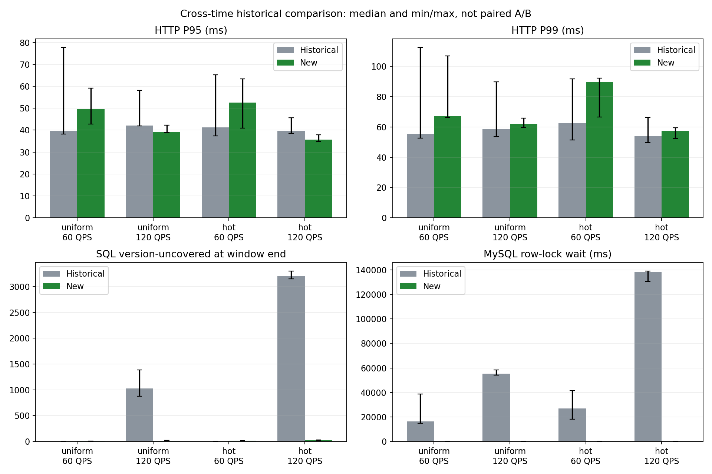
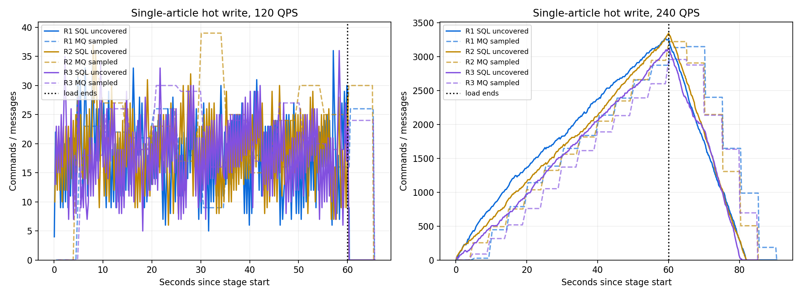

# 点赞新版与历史实现性能对比

日期：2026-11-18。只运行新版，复用三个已核验历史样本；这是跨时间观测，不是同步配对A/B，也不能把全部差异归因于聚合改造。

## 结论

本次观测中，收益主要体现在高负载后台SQL版本覆盖与行锁竞争，HTTP受理延迟没有全面改善。四组主对比的实际成功QPS中位数差异均在5%以内，全部已发点赞请求均202受理，无采样错误。

- 120 QPS轮转文章的阶段末待覆盖中位数从1,026降至9，单文章热点从3,210降至28，均约减少99.1%。这是SQL版本覆盖口径，不能改写为历史MQ队列深度。
- 固定300请求的SQL覆盖恢复中位数从3,119ms降至879ms，约缩短71.8%；物理ACK排空观察值单列，不参与该比例。
- 60 QPS两场景的HTTP P95中位数上升约25.3%和27.2%；120 QPS P95下降约6.7%和10.0%，但四组P99中位数均上升约5.8%至43.7%。因此不能宣称接口延迟整体优化。
- 新版主对比测得行锁等待增量为0，不代表没有数据库或队列瓶颈。240 QPS单文章热点三轮末待覆盖3,116至3,346条，停压后仍需约20.6至22.1秒完成SQL覆盖，单热点持续处理边界仍然存在。
- 分实例计数表明，本次文章组处理全部集中在实例0，实例1处于备用。SAC保证队列单活，不保证活跃分区在实例间均衡；本实验也未提供独立实例CPU/堆隔离。

## 测试与证据

测量提交：`5c317017dece41b7604a9370a3875d31315072f8`。三轮、每阶段60秒，共151,506个点赞HTTP原始样本、21个写入阶段。固定积压阶段每轮300请求。原始记录：`artifacts/performance/20261118-022300-cde9970a/`。

旧样本为20261116-113300-1b831540的round-1/2和20261116-120704-560d41cc的round-1。前一运行整体中断，但这两个点赞轮次完整；不是把缺失轮次补成成功。历史CSV、JUnit、SQL对账和SHA256均复核，历史文件未修改。

使用原专用Compose持久卷与资源限制：MySQL 2CPU/1.5GiB、Redis 1CPU/256MiB、RabbitMQ 2CPU/768MiB、ES 2CPU/1.5GiB。16用户、32文章，每用户一个在途请求；两个应用上下文和客户端共享一个Xmx768MiB测试JVM，未限制应用CPU。真实Session/CSRF接口，测试阈值提高，不改变生产配置。

新版4分区、批大小20、收集等待100ms、prefetch20。uniform沿用每16个计划请求轮换文章的旧规则，实际是轮转热点；不冒充独立均匀随机。240 QPS放在历史对比和积压恢复之后。

## HTTP受理对比

表中为各轮中位数[min,max]，延迟单位ms；不平均百分位，不强行配对。成功QPS匹配阈值为5%。

| 场景/目标 | 旧成功QPS中位数 | 新成功QPS中位数 | 旧P95 | 新P95 | 旧P99 | 新P99 |
|---|---:|---:|---|---|---|---|
| 轮转文章/60 | 59.98 | 59.99 | 39.54 [38.23, 77.84] | 49.53 [42.82, 59.25] | 55.40 [52.52, 112.67] | 67.10 [66.36, 107.03] |
| 轮转文章/120 | 119.78 | 119.78 | 42.12 [41.87, 58.14] | 39.30 [38.84, 42.35] | 58.68 [53.50, 89.84] | 62.08 [59.74, 65.93] |
| 单文章热点/60 | 59.99 | 59.99 | 41.26 [37.29, 65.18] | 52.50 [40.97, 63.41] | 62.34 [51.32, 91.87] | 89.56 [66.49, 92.24] |
| 单文章热点/120 | 119.95 | 119.93 | 39.59 [38.58, 45.67] | 35.65 [34.89, 37.87] | 53.82 [49.58, 66.30] | 57.23 [52.43, 59.44] |

## SQL覆盖与行锁等待

acceptedPending表示HTTP已受理但尚未观察到SQL版本覆盖的命令数，不是MQ队列深度。行锁统计为专用MySQL的全局计数差。

| 场景/目标 | 旧/新阶段末待覆盖中位数 | 旧/新行锁等待次数中位数 | 旧/新累计行锁等待ms中位数 |
|---|---:|---:|---:|
| 轮转文章/60 | 3 / 5 | 1652 / 0 | 16256 / 0 |
| 轮转文章/120 | 1026 / 9 | 3440 / 0 | 55202 / 0 |
| 单文章热点/60 | 2 / 12 | 2013 / 0 | 26845 / 0 |
| 单文章热点/120 | 3210 / 28 | 3992 / 0 | 138077 / 0 |

## 固定积压恢复

三次历史SQL覆盖恢复为[2890, 3161, 3119]ms；新版为[891, 856, 879]ms。两组各自中位数为3119ms与879ms，没有逐轮配对。

| 新版轮次 | 已受理 | SQL覆盖恢复ms | 管理API物理ACK排空观察ms |
|---|---:|---:|---:|
| 1 | 300 | 891 | 9202 |
| 2 | 300 | 856 | 3232 |
| 3 | 300 | 879 | 8692 |

SQL覆盖按250ms轮询，覆盖时间不是精确提交时间。Broker每秒采样但内部默认约5秒异步刷新；物理排空还要求累计ACK达到受理量。因此物理排空观察值含统计刷新延迟，不能与历史SQL覆盖耗时混算。

## 新版逐轮结果与成本

| 轮次 | 场景/目标QPS | 成功QPS | P95/P99 ms | 忙跳过 | 末待覆盖 | SQL尝试/完成组 | 合并消息 | 计数UPDATE |
|---|---|---:|---:|---:|---:|---:|---:|---:|
| 1 | 轮转文章/60 | 59.99 | 49.53/67.10 | 0 | 11 | 592/592 | 0 | 592 |
| 1 | 轮转文章/120 | 119.09 | 42.35/59.74 | 53 | 9 | 894/894 | 0 | 893 |
| 1 | 单文章热点/60 | 59.98 | 52.50/89.56 | 0 | 12 | 295/295 | 60 | 288 |
| 1 | 单文章热点/120 | 119.95 | 35.65/52.43 | 0 | 29 | 362/362 | 1423 | 354 |
| 1 | 固定300请求恢复/60 | 59.71 | 42.91/61.70 | 0 | 300 | 31/31 | 0 | 31 |
| 1 | 轮转文章探索/240 | 238.35 | 41.84/60.89 | 93 | 35 | 963/963 | 0 | 956 |
| 1 | 单文章热点探索/240 | 238.23 | 39.20/59.75 | 100 | 3247 | 716/716 | 2869 | 600 |
| 2 | 轮转文章/60 | 59.99 | 42.82/66.36 | 0 | 5 | 611/611 | 0 | 611 |
| 2 | 轮转文章/120 | 119.78 | 38.84/65.93 | 11 | 20 | 895/895 | 0 | 893 |
| 2 | 单文章热点/60 | 59.99 | 63.41/92.24 | 0 | 14 | 298/298 | 92 | 277 |
| 2 | 单文章热点/120 | 119.93 | 37.87/59.44 | 0 | 28 | 362/362 | 1430 | 353 |
| 2 | 固定300请求恢复/60 | 59.79 | 51.43/61.68 | 0 | 300 | 31/31 | 0 | 31 |
| 2 | 轮转文章探索/240 | 237.70 | 41.62/59.97 | 132 | 49 | 940/940 | 0 | 940 |
| 2 | 单文章热点探索/240 | 239.32 | 35.81/52.79 | 35 | 3346 | 719/719 | 2881 | 576 |
| 3 | 轮转文章/60 | 59.83 | 59.25/107.03 | 10 | 4 | 604/604 | 0 | 603 |
| 3 | 轮转文章/120 | 119.95 | 39.30/62.08 | 0 | 8 | 902/902 | 0 | 899 |
| 3 | 单文章热点/60 | 59.99 | 40.97/66.49 | 0 | 9 | 315/315 | 25 | 305 |
| 3 | 单文章热点/120 | 119.70 | 34.89/57.23 | 16 | 23 | 361/361 | 1427 | 305 |
| 3 | 固定300请求恢复/60 | 59.90 | 38.37/94.27 | 0 | 300 | 31/31 | 0 | 31 |
| 3 | 轮转文章探索/240 | 238.78 | 39.70/54.23 | 63 | 49 | 921/921 | 0 | 921 |
| 3 | 单文章热点探索/240 | 238.35 | 37.24/57.45 | 93 | 3116 | 716/716 | 2865 | 660 |

SQL次数为测试MyBatis拦截器统计的Mapper调用，包含关系初始化、锁定、更新及计数锁定、更新，不等于磁盘写次数；观察用JdbcTemplate查询不计入。两实例计数先分别求差再相加。历史没有这些完整计数，不反推旧值。

实线是SQL待覆盖命令数，虚线是MQ ready+unacked异步采样，竖线是60秒发压结束。两种计数不能互相替代。240 QPS是探索，不是持续容量上限。

## 验证与限制

- 21个阶段的HTTP原始数量、状态、调度索引、起止时间和P50/P95/P99复算通过；SQL覆盖记录与受理版本逐项对应。
- 聚合前后消息数量、关系裁决和Mapper调用计数核对通过；每阶段最终目标与版本、每篇文章关系之和及计数一致，全部队列最终排空。
- 新旧仅跨时间比较。旧样本来自All运行的两个轮次及Like补测一轮；本次只测Like。新增采集也有开销，同机后台负载、JIT、磁盘缓存和调度可能影响结果，三轮范围不代表置信区间。
- 本次单活消费者的处理可能集中到一个实例，分实例组数见JSON/CSV，不声称自动均衡。单文章240 QPS的积压边界必须保留。
- 短烟测不纳入结论；没有重跑旧实现或修改历史文件。测试完成关闭应用及本次启动的专用容器，保留卷；开发服务保持原状。

精选诊断见[JSON](like-history-comparison.json)与[CSV](like-new-diagnostics.csv)，完整原始数据保留在运行目录。
