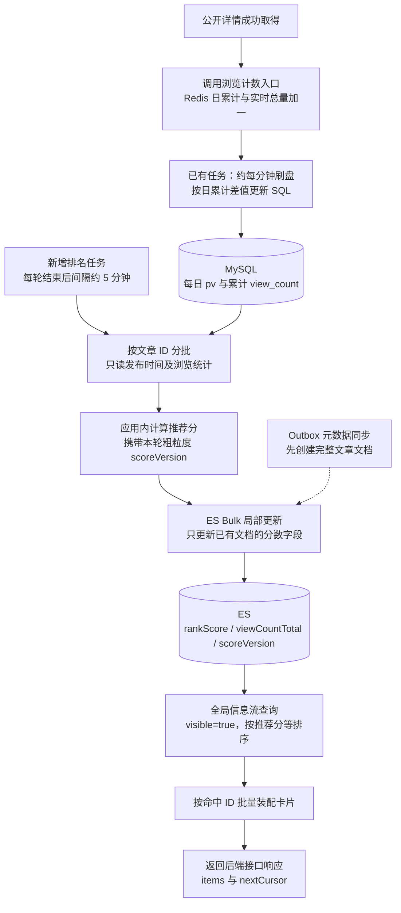
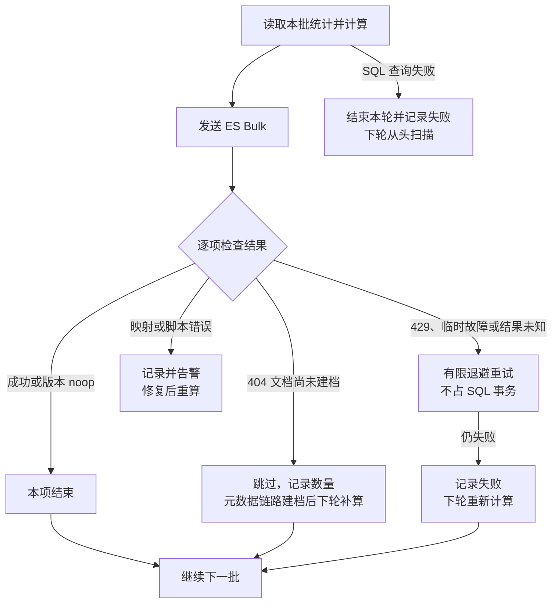

# ES 与推荐分后端设计复核

2026-11-08 修订。仅讨论后端交付；本文替换此前审阅稿，原交接方案未改。只修改文档，未实现业务代码或运行测试。

## 1. 收敛后的结论

采用“可靠元数据同步 + 近似定时排名”。文章状态和索引字段隔离要正确；分数允许相近时间覆盖，并由下一轮重算修正。后端接口允许少量陈旧卡片，不额外逐篇/逐批查询文章状态，也不把客户端行为作为后端完成条件。

| 优先顺序 | 后端必须处理的边界 | 恢复性与成本 |
|---|---|---|
| 1 | 文章、Tag、引用及 Outbox 同事务 | 保护权威业务事实；沿用现有文章行锁，不增加全局锁 |
| 2 | Outbox 可靠交接、metaVersion 防倒退、隐藏墓碑、元数据/分数字段分开更新 | 缺失或错误可能长期残留，但 SQL 完整时可补扫/重建；保留原方案的低成本保护 |
| 3 | 网络请求不持 SQL 锁；领取、回源、重试与补齐有界 | 防止锁竞争、连接池拥塞及故障扩大；比严格排列分数批次更值得优先投入 |
| 4 | 有版本保护的初始化、维护窗口重建、正确游标 | 避免索引长期缺数据及会话跳项；不要求首版在线双写或持久分页会话 |
| 5 | 近时分数覆盖、旧缓存、初始零分、短时排名滞后 | 接受，下一轮/TTL/刷新收敛；不增加排名锁、持久批次表或可靠缓存队列 |

缓存失效尽力执行，不成为 ES 消费 ACK 的前提。查询已知隐藏/不存在的项跳过；依赖异常返回错误，不能伪造文章不存在。响应定义 items、nextCursor 和明确的游标过期错误；空页但仍有候选时可以保留 nextCursor。

## 2. 推荐分完整链路

推荐分不是每次浏览时计算，而是两条独立后台链路衔接：先把浏览量累计落库，再定时读库算分。排名任务不主动触发刷盘，也不等待它完成。

这里存在一个此前漏出的实际接入缺口：**ArticleViewService.record 已有实现，但当前主源码中未发现详情 HTTP 链路调用它。** 必须补上“取得公开详情后尝试计数”，缓存命中也计数；列表读取不计数，读取失败不计数。计数故障不应阻断正文返回，未知写入结果不重复加一。计数口径是后端成功取得详情，不保证用户实际读完。

### 计算输入与公式

使用既有 Asia/Shanghai 业务日，D 为本轮开始时的日期，整轮固定即可；跨午夜不需要暂停任务或加锁。

`view7d = SUM(pv)，stat_date 在 D-6 到 D 之间`

`rankScore = log1p(view7d) + λ × hours(publishedAt - fixedEpoch)`

- 输入只来自已落库的七个业务自然日浏览量和首次发布时间；没有日记录时浏览量为 0。SQL 查询失败不当作 0。
- λ 非负，越大越偏向新文章；fixedEpoch 固定。时间项表达年龄偏好，不必每秒全站重算。编辑不刷新 publishedAt。
- **取消所有点赞因子。** 不将 Redis 累计桶直接加到 SQL 上；卡片实时计数与 ES 排名值允许不同步。
- 若 Tag 热门要按累计浏览量排序，同批读取 article.view_count 并更新 viewCountTotal；它不额外加入上述推荐公式。

### 一轮任务具体怎样执行

1. 固定一个实例启用排名调度，同实例上一轮结束后再运行下一轮；无需分布式任务锁。本轮开始时取时间戳作为粗粒度 scoreVersion，同时记录业务日及扫描最大文章 ID。
2. 按 `id > afterId AND id <= maxId` 主键分页选公开文章，例如每批 500 篇。每批读取 id、published_at、view_count，再一次分组查询这些 ID 的七日日桶；不查正文，不逐篇 SELECT。
3. 查询使用普通只读语句，不加 FOR UPDATE，不要求各批同一快照。结束数据库读取后在内存计算，再调用 ES，避免长事务和网络等待占住数据库连接。
4. Bulk 仅写 rankScore、viewCountTotal（需要时）和 scoreVersion，不改 visible、标题、Tag 或 metaVersion。可以保留 scoreVersion 大于旧值才更新的简单脚本，但不把它当作精确统计水位。
5. 处理本批结果后推进 afterId，继续到本轮上界；新文章留到下一轮。每轮都扫描全部公开文章，因此即使没有新浏览，七日窗口滑出的文章也会降分。

固定单实例是部署配置，不是依赖严格主节点选举；意外双实例的近时覆盖允许发生，注意限制重复扫描负载即可。无需持久批次序号、排名状态表或跨存储统计快照。

## 3. 失败后的处理闭环

这里的持久补偿来源是 SQL 和下一轮完整扫描，不是失败任务表。短时失败保持原分数；相近计算相互覆盖可接受，禁止的是旧失败批次无限重试或用统计更新覆盖文章元数据。ES 文档缺失时不由分数任务 upsert，避免产生缺少文章状态的半文档。

新建文章可以暂时为零分，下一轮补算；隐藏文章由元数据链路将 visible 设为 false，排名不负责再改状态，也不要求旧分数清零。分数更新与隐藏同时发生时，只要两组字段互不覆盖即可。

## 4. 代码缺口与后端验收

| 当前代码 | 最小补充 |
|---|---|
| 浏览计数、Redis 日桶、每分钟差值落库已实现，但未发现详情入口调用 record | 接入详情读取后的计数；先让排名有真实输入 |
| 工作区已有独立 ES 开发 Compose，后端尚未接入 | 客户端、Mapping/别名、metaVersion/Outbox、Relay 和消费者 |
| 已有每日浏览表和累计浏览量，无每日点赞 | 新增主键分段、七日聚合查询、仅浏览量算分与 Bulk 任务；不建点赞日表或排名批次表 |
| 列表 MGET/SQL 批量回源已有，但 authorPage 限同一作者 | 抽公共跨作者装配核心，新增搜索/feed/PIT 接口 |
| 浏览刷盘按整个日期执行写事务，逐篇更新 article | 数据多时可能延长编辑锁等待；排名不复用这个写事务。确认已成瓶颈再拆刷盘批次 |

后端验收只检查：元数据可靠同步且不回退；排名只更新分数字段；无浏览文章和窗口滑出文章会参与重算；近时分数覆盖不报错；Bulk 失败能在后续扫描修正；冷缓存批量回源、热缓存不查文章状态；分页不跳过未消费候选，错误与结束有明确区分。允许陈旧结果是接口一致性约定，不要求实现任何前端逻辑。

最小监控保留排名最近完整成功时间、失败项数量及 Outbox/DLQ 积压即可。未落库浏览量因 Redis 丢失/日桶过期而损失，属于现有近似统计边界，不因接入 ES 扩大成可靠计数改造。

