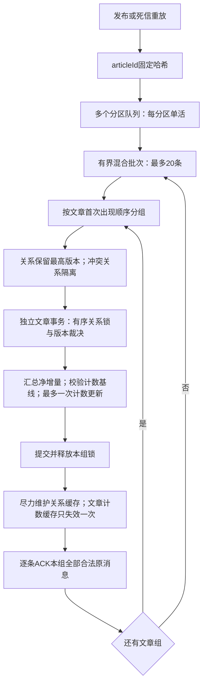

# 文章点赞实施与运维协议

> Windows 命令中的 `JAVA_SOCKET_TMPDIR` 需由运行者预先设置为本机可用的短ASCII绝对路径，并确保目录已创建；其他平台可省略该JVM参数。此环境变量仅用于展开本文命令，不是应用配置。

## 已确认边界

- 后端闭环，文章详情和作者列表追加 `likeCount`、`likedByMe`；不修改其他工作区前端，不新增公开批量查询。
- 每关系一行状态和最高版本，取消保留墓碑；关系与精确计数同事务。没有历史表、Outbox、计数分片和HTTP请求去重。
- 单节点依赖，验证两个应用实例；Redis正常关闭并持久化后重启沿用原纪元，异常宕机后在业务实例启动前人工恢复纪元，已有消息按版本裁决。
- Redis中的点赞状态和计数只是展示缓存，签发器则是持久数据；前端乐观计数，Redis展示计数不做INCR。状态固定600秒、计数固定30秒，不滑动续期。
- 点赞缓存失败回源SQL；没有可靠数据时整个接口503，不能伪造零或未点赞。

## 接口约定

`PUT /api/articles/{articleId}/like`设置点赞，`DELETE`设置取消。必须携带UUID格式的`X-Operation-Id`，沿用Session/CSRF。每次HTTP调用都会重新分配版本，operationId只作追踪。

202响应为`{accepted:true,operationId,liked,version}`，version是十进制字符串。只有路由成功且Broker确认后返回；liked是受理目标，不是SQL提交证明。旧响应不得覆盖前端新目标；超时结果未知，不无限重发旧意图。

| 场景 | HTTP / code |
|---|---|
| 参数或UUID非法 | 400 / INVALID_LIKE_REQUEST |
| 文章不存在或隐藏 | 404 / ARTICLE_NOT_FOUND |
| 频率超限 | 429 / RATE_LIMITED，附Retry-After |
| 分配器暂停、缺Key、异常TTL、纪元不一致或序号无效/耗尽 | 503 / LIKE_ALLOCATOR_UNAVAILABLE |
| 明确未开始发布 | 503 / LIKE_PUBLISH_UNAVAILABLE |
| 无路由 | 503 / LIKE_PUBLISH_REJECTED |
| 发布后无法确认 | 503 / LIKE_WRITE_RESULT_UNKNOWN |

## 实施批次

> 以下批次是原实施过程记录，不是当前待办；接口、配置及运维约束按当前实现维护。

1. 协议与文档；2. SQL迁移和消费事务；3.可靠发布；4.消费、死信及重放；5.分配器和恢复；6.批量缓存查询；7.API与文章响应；8.集成故障测试、指标、容量报告。

每批独立验证并小步提交，保留无关未跟踪文档。新增SQL从V5开始，不改旧迁移。点赞固定集成，正常Web应用默认提供查询、写入并消费MQ；上线时由运维关闭外部入口，完成依赖与纪元准备后再开放。

## 实际实现与默认配置

SQL迁移为`V5__create_article_like.sql`，会为公开和隐藏的已有文章初始化零计数。新建文章在同一事务建立计数。取消和账号注销不清关系墓碑；没有在线物理删除或自动修数入口。

详情和作者列表始终在共享内容取出后追加`likeCount`和`likedByMe`，游客恒为false，编辑接口不追加。正常点赞查询最多两条批量回源SQL；认证已有的SQL校验不计入该数量。

| 配置 | 默认值 / 说明 |
|---|---|
| LIKE_PER_MINUTE | 每用户每分钟60次，仍叠加现有认证入口限流 |
| LIKE_CONFIRM_TIMEOUT | 2s，只是确认等待预算，不是完整HTTP延迟承诺 |
| app.like.pending-limit | 128 / 实例，超限在发送前拒绝 |
| LIKE_PARTITION_COUNT / app.like.partition-count | 固定4分区，全部实例和重放命令必须一致；取值1至64 |
| LIKE_BATCH_SIZE / app.like.batch-size | 每批最多20条，单篇文章组自然不超过此值 |
| LIKE_BATCH_WAIT / app.like.batch-wait | 100ms，同时设置接收等待和整体收集等待，不是端到端提交时限 |
| LIKE_PREFETCH / app.like.prefetch | 每分区20条，不得小于批大小 |
| app.like.queue-bytes | 每个分区及共享DLQ各64MiB，默认配置合计320MiB的队列正文预算；不含在途投递与Broker额外开销；脚本QueueBytes需保持一致 |
| app.like.read-timeout | 每次批量回源默认等待300ms，同键在途查询由请求共享，SQL 并发由数据源连接池控制 |
| MANAGEMENT_PORT | 18081，本机管理端口；第二实例必须改成其他端口 |

上述`app.like.*`均可通过Spring命令行属性覆盖。普通应用重启不初始化分配器或提升纪元。分配器Key无TTL，展示缓存单独位于`<namespace>:cache:v1:*`，不要通过修改namespace来清理缓存。

`ALLOCATE`和`CHECK`验证Key类型、持久性、合法epoch/seq、guard纪元一致、runId非空、READY状态及可写主节点，不要求guard.runId等于当前Redis运行标识。旧runId保留初始化记录，正常Redis重启后seq继续递增，status及健康检查不消耗序号。初始化新纪元必须先暂停；激活仍要求guard、当前Redis及维护目标运行标识一致，防止迟到激活。

## 分区聚合消费

发布与死信重放统一使用 `floorMod(Long.hashCode(articleId), partitionCount)`，经持久Direct Exchange进入 `command.p{n}.q`，路由键为 `article.like.set.p{n}`。每队列配置Quorum和Single Active Consumer；每实例注册独立串行监听容器，多个实例提供备用消费者，全系统最多4个活跃分区消费者。活跃分区不保证均匀分布到实例。



同一关系任意同版本出现不同状态，会隔离该关系在本批内的全部消息，包括被更高版本覆盖的消息。合法关系在事务中按userId升序初始化、锁定并裁决；取消保留墓碑。净增量为零仍保存版本并锁定校验计数基线，计数缺行、下溢或溢出整组回滚。事务保持READ COMMITTED、5秒超时，不访问Redis/MQ。

每文章组最多尝试5次，退避1/2/4/8秒；重试耗尽或SQL不变量错误只隔离当前组，下一文章继续。缓存使用数据库裁决结果，STALE跳过，APPLIED/DUPLICATE逐关系尽力CAS，一条失败不阻止其余，最后对文章计数缓存删除一次。缓存失败仍ACK已提交消息。ACK/NACK始终multiple=false；确认失败或中断关闭Channel，让Broker重新投递剩余消息，版本幂等负责消除重复计数。

删除旧 `app.like.concurrency` 配置。分区数或算法变化必须停实例切换，不允许新旧规则混跑。固定分区减少同文章消费者竞争，但不能拆分单篇热点，同分区慢组重试仍会延迟其他文章。

## 轻量验证

仓库根目录执行 `./infra/test/run-like-tests.ps1 -Light`。入口明确选择聚合、路由、消费、缓存和配置单测，以及真实MySQL文章事务、同JVM RabbitMQ连接接管测试；不启动HTTP闭环、应用重启、容器故障或容量实验。相关旧测试仍需通过test-compile，容量实验保留显式Load入口。

## 部署、重启和故障运维

完整操作步骤统一见[点赞运维手册](../../../operations/like/zh-CN/like-system-operations.md)，包括两个.env示例、AMQP与管理端口、首次初始化、普通应用重启、Redis/MySQL/RabbitMQ宕机、整机恢复、死信及数据回滚边界。

正常Web应用自动提供点赞能力，不再读取旧模块、写入或消费开关。关闭外部端口时，后台消费者仍处理已受理命令；需要暂停消费时停止应用。纪元恢复前必须停止全部业务实例，恢复后在外部入口关闭期间完成本机验证，最后人工开放。

普通应用启动不会自动初始化或提升纪元。分配器未就绪时写接口503且健康检查异常，但不停止消费者；不增加自动恢复、自动开网或状态修改HTTP接口。非Web维护命令不启动消费者、自动MQ拓扑或业务定时任务，只有replay显式连接MQ。

本地正常停机按“停止新请求 → 等待在途发布和消费完成 → 停止应用 → 正常关闭并持久化依赖”执行；MQ排空不能替代Redis持久化确认。Redis异常退出、整机断电或无法确认序号完整性时，保持全部业务实例停止，先执行现有recover提升纪元，再检查并启动。仅应用崩溃而Redis始终正常且签发器有效时，无需提升纪元；缺Key、异常TTL、PAUSED等仍须受控恢复，旧备份回滚按专项恢复处理。

保持现有AOF配置，不增加逐次WAITAOF等待。运行标识不用于自动区分正常关闭和意外宕机，health/status也无法检测历史序号回退；异常宕机后即使ready=true，仍必须先恢复纪元。这一安全边界依赖运维流程，不由应用自动阻止写入。

## 前端接入

同文章只保留一个在途写请求，点击立即改变本地目标，快速切换合并为最终目标；仅本地布尔状态实际改变时加减显示计数。旧HTTP响应不覆盖后来意图。

operationId是追踪标识，同一个ID再次HTTP调用也会获得新版本。超时意味着未知，不无限重发已被新意图取代的请求；刷新后允许采用服务端暂时落后的展示。没有严格跨故障请求幂等、逐操作查询或读己之写保证。

Redis Pending只是尽力展示；Hash丢失后旧回调可能短暂写回旧状态。固定600秒/30秒是单次缓存寿命，不是包含MQ积压、进程暂停或DLQ修复在内的全链路收敛时限。

## 自动化验证

正常重启兼容逻辑可单独使用一个隔离临时Redis验证：设置`IT_REDIS=true`及对应的`IT_REDIS_HOST/PORT/PASSWORD`，在backend目录运行`mvn "-Dtest=LikeAllocatorIntegrationTests,LikeSqlServiceTests,LikeWriteServiceTests" test`。分配器测试仅操作随机命名空间，不需要MySQL、RabbitMQ或Web；不要将连接参数指向开发Redis。验证后清理临时Redis。

2026-11-17本次修复的定向验证：临时Redis 7.4上23项真实Lua/分配器测试、4项SQL版本裁决单元测试及2项写服务单元测试全部通过，无失败或跳过。覆盖旧runId继续签发、只读健康检查、数据异常拒签、维护激活校验、回退后提升纪元及多实例并发唯一性；未执行真实Redis重启、MySQL/RabbitMQ集成、HTTP、压测或整机故障演练。原重启测试仅同步新预期并通过测试源码编译。

```powershell
# 仅操作独立测试项目，首次自动创建随机凭证，保存在被Git忽略的backend/.env.like-it。
./infra/test/run-like-tests.ps1
# 显式启用只针对带ec.like.test标签容器的重启/进程崩溃演练。
./infra/test/run-like-tests.ps1 -Faults
# 全量clean verify，同时开启原有文章MySQL/HTTP和Redis回归。
./infra/test/run-like-tests.ps1 -Verify -Faults
# 独立Redis7.2兼容实例：真实执行分配器和缓存Lua，不进行重启实验。
./infra/test/run-like-tests.ps1 -Redis72
# 构建后，以实际JAR验证status/pause/recover/replay/audit和失败退出码。
./infra/test/like-maintenance-smoke.ps1
# 双实例阶梯负载，默认每阶段15秒；可用IT_LIKE_LOAD_SECONDS延长至300秒。
./infra/test/run-like-tests.ps1 -Tests LikeCapacityTests -Load
```

测试库为`easy_community_like_test`，端口17706/17779/17772，管理端口17773；不复用开发容器。Windows测试JVM使用短ASCII临时套接字目录，不更改系统设置。

同一个专用测试项目必须顺序执行，不能同时运行多个测试入口或旧版对照测试。Windows JDK25若本机临时目录导致`UnixDomainSockets Invalid argument`，执行实际JAR时也需在`-jar`前添加`"-Djdk.net.unixdomain.tmpdir=$env:JAVA_SOCKET_TMPDIR"`（换成已创建的本机短ASCII目录）；测试脚本已处理该参数。

Redis7.2兼容实例使用17778端口；历史验证覆盖7.2和7.4的Lua INFO、维护校验及19位字符串比较，不代表当前版本已重新进行兼容验证。分配器恢复用户需要INFO和CONFIG GET权限，应用用户至少需要脚本使用的INFO及相关Key读写权限；权限不足必须拒签。不要将测试凭证用于开发或生产。结束实验可使用相同Compose文件及`--env-file backend/.env.like-it --profile compatibility down -v`清理本测试项目。

容量JSON输出到`backend/target/like-capacity.json`，记录认证在内的HTTP延迟、响应分类、接受后待提交数量、SQL锁等待及对账结果。每个用户客户端串行，两个应用实例共享Session、签发器和队列。热读预热后测量，冷读从清除本实验展示缓存开始；不会清理签发器。

指标标签只包含固定动作、结果及有限分区编号，禁止用用户/文章ID作为标签。新增article.like.batch.size、article.like.group.size、article.like.coalesced、article.like.group.duration及article.like.partition.events，SQL耗时不含退避。Broker队列深度和磁盘、MySQL锁等待使用原生监控；队头时间不可用时明确标记未知。消费者排队年龄是投递采样，不冒充全队列最老消息年龄。

历史报告对应逐条消费实现，不能作为新版聚合消费者的性能结论。历史双实例容量实验使用本机共享资源、MySQL tmpfs 和每阶梯30秒的短窗口：120 QPS写入待提交量基本稳定，240 QPS出现积压。该结果不代表当前版本复测或生产SLA。正式环境必须使用目标硬件、持久磁盘和长窗口重新验证，确认入口限额、队列预算及消费者配置；保持外部入口关闭直到人工验收完成。

历史验证曾取得无测试方法排除项的完整回归通过，不代表当前版本已重新执行。当前版本应按本节命令分别记录通过、跳过和真实依赖验收范围，不沿用历史媒体测试排除项。

新版已完成三轮、每阶段60秒的[历史对比测量](../../../../development/reports/performance/2026-11-18/like-history-comparison.md)：120 QPS下SQL待覆盖量及固定积压恢复改善，但HTTP尾延迟没有全面下降，240 QPS单文章热点仍会积压。该记录只复用旧样本，不是同步新旧配对实验。
