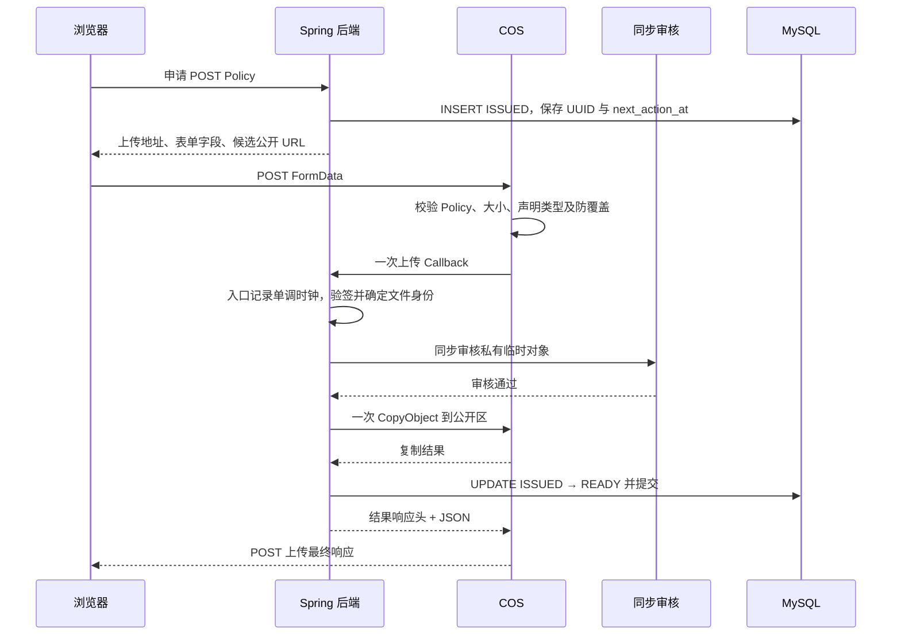
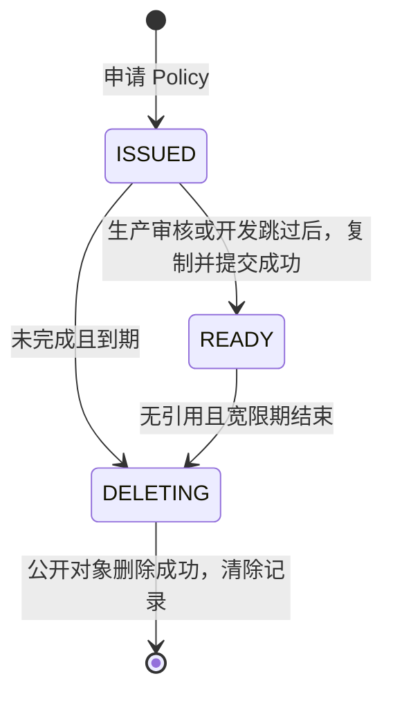

# 文件服务 V2 计划：动态 Upload URL、POST Policy 与上传通知

本文是文件服务V2设计，当前实现及部署见[接入说明](media-service.md)，更新于 2026-10-29。设计基于[上传系统讨论](https://chatgpt.com/share/6ae1b282-8034-83e8-980a-3b32bafc78de)、[开发与生产差异讨论](https://chatgpt.com/share/6ae2127c-f0e0-83ec-9438-62df62d03aaf)及[最新一轮精简表设计](https://chatgpt.com/share/6ae21d69-0af0-83ee-8e31-93c103ae2633)。后端签发凭证时动态返回 Upload URL，前端只按返回的上传描述和 COS 生产结果契约实现一套逻辑。生产 Callback 使用默认4.5秒的入口协作式预算，超时由COS向浏览器报告CallbackFailed，本地由 MinIO Webhook 发布，允许成功响应早于公开对象可读。不模拟等待 1 秒，不使用开发 complete、状态轮询或 Spring 文件中转网关；本地兼容上传入口负责统一响应格式。

本次重构不兼容 V1：直接重整数据定义、上传协议、服务和测试，移除旧入口与旧状态，不设计旧版迁移、双写、双轨运行或兼容开关。本文与当前协作式截止实现保持一致；数据结构与存储定位规则不因超时简化而改变。

## 1. 确定的设计原则

- 浏览器申请 POST Policy 时，由后端同时返回动态 Upload URL，字段固定为 `upload.url`。后端决定生产与开发使用的上传入口，前端原样发送表单并解析统一结果，不按 dev/prod 切换流程或查询状态。
- COS 接收文件后发起一次 Callback；后端验签并确认文件身份后，直接同步审核，通过后复制到公开区，提交 READY，然后响应回调。
- MinIO 对临时区 POST 上传发送 Webhook；后端验证通知后直接复制并提交 READY。本地不调用真实审核、不模拟耗时、不接收文件正文。
- 上传回调不使用 SQL 领取、Redis 锁、发布租约、处理中状态、重复回调协调或接管机制。
- 审核、复制和最终提交各执行一次，关闭 SDK 和应用层自动重试。任何一步失败或超时立即结束，不继续发布；用户重新申请新的文件 ID 上传。
- 生产非超时回调响应头写明处理阶段和结果，JSON 携带同义结果；超时返回504空正文，仅在日志记录原因，由COS生成浏览器侧203；本地存储代理将 MinIO 上传结果整理为相同结果结构，不等待 Webhook。Webhook 响应仍发给 MinIO。
- 定时任务只清理未完成记录、无引用对象及删除失败项，不恢复审核或复制。
- 本地 MinIO 不要求防覆盖，也不将 If-None-Match: * 用于 POST Policy 验收。

生产成功必须表示真实审核、公开复制和 READY 提交均已完成。本地是明确接受的开发近似：存储接收后按相同格式返回成功，Webhook 随后完成复制和 READY 提交，图片可能短暂不可读，刷新后查看即可。前端不为本地增加等待、查询或重试分支，生产成功条件不能因此放宽。

## 2. 双区存储与文件身份

第一版使用专用桶内的双前缀，不强制拆成两个桶：

| 区域 | 对象路径 | 权限与清理 |
|---|---|---|
| 私有临时区 | `{envPrefix}/temp/{mediaId}` | 表单只授权指定 Key；禁止匿名读取；一天生命周期 |
| 公开持久区 | `{envPrefix}/public/{mediaId}` | 仅后端可写，匿名可读；按业务引用 GC |

申请时生成随机 UUID mediaId，两个 Key 都根据 ID 和固定路径规则生成，不保存到 SQL。桶、厂商、环境前缀和公开域名由当前环境配置管理。文件名只在请求或界面中用于展示，不持久化为文件字段，也不参与对象路径。授权响应统一提供稳定的 mediaId 与 publicUrl，公开 URL 不包含 Policy、签名或上传凭证。前端在统一上传结果成功后使用授权中的 publicUrl，不依赖上传响应再次提供 URL。本地即使公开文件还未复制，URL 字符串也已经确定；允许的是短暂缺图或不可读，不是为 dev 返回不同结构或空 URL 字段。

类型先限定 JPEG、PNG、WebP，公开 Key 不带扩展名，读取时依靠对象 Content-Type；这样即使 ISSUED 的 mime_type 尚未确定，也能推导公开 URL 和失败残留的位置。Policy 校验声明 Content-Type 与文件字节长度，不检查二进制内容是否真的是图片。生产真实内容合法性由同步审核把关，本地跳过这一步，不将开发结果当作真实图片校验。第一版不额外增加全文件下载、HEAD 复核或独立解码流水线。

生产 COS 通过签入 Policy 的 `x-cos-forbid-overwrite=true` 约束防覆盖，使用支持该语义的未启用版本控制桶。审核和复制针对同一个不可覆盖的临时源；复制可携带回调给出的源 ETag 条件。

开发 MinIO 允许同 Key 再次写入，不增加锁或条件 PUT 来模拟生产防覆盖。正常开发操作仍每次申请新 mediaId；重复或并发覆盖场景不作为本地与生产语义一致的保证。

“移动到公开桶”按逻辑发布理解：生产与开发均使用真实 CopyObject 复制到由 ID 推导的公开 Key，不在回调或 Webhook 中删除临时源。临时对象统一交给一天生命周期清理；该规则异步执行，不承诺精确到第 24 小时整。同桶双前缀继续作为第一版部署方式。

## 3. POST Policy 授权与动态 Upload URL

`POST /api/media/uploads` 继续使用 Session + CSRF。已认证用户提交用途、文件名、声明 Content-Type 和大小，后端完成必要业务校验，写入 ISSUED 后返回授权。

文件用途只保留 AVATAR 和 ARTICLE_IMAGE：头像上传上限 2 MiB，文章图片上传上限 10 MiB；封面是文章图片的一种业务使用位置，绑定封面时再验证不超过 5 MiB，不另存 ARTICLE_COVER 用途。生产大图审核配置和实际耗时必须与上限匹配。uploader_id 从认证上下文取得，不能接受客户端指定。

声明类型和大小用于本次申请校验与签名 Policy，不另存 declared_* 字段。ISSUED 先保存身份、用途、创建时间和回收时间，mime_type / size_bytes 可以为空；完成处理时再写入可信结果元数据。

| Policy 条件 | 约束 |
|---|---|
| expiration | 短期有效，例如签发后 5 分钟 |
| bucket | 固定项目桶 |
| key | 精确匹配本次临时 Key，不用文件名通配符或宽泛前缀 |
| Content-Type | 精确匹配本次允许的声明类型，不只匹配 image/ |
| content-length-range | 按本次声明大小设置上下界为同一值；申请时已检查用途上限 |
| COS x-cos-forbid-overwrite | 固定 true，作为受签名约束的表单字段 |
| COS x-cos-callback | 固定服务端生成的完整回调参数，纳入 Policy 条件 |
| 回调自定义字段 | 使用时逐项固定，不能让前端替换文件身份或回调地址 |
| ACL 等权限字段 | 固定安全值，禁止上传者将临时对象设为公开 |
| success_action_status | 固定为 200；生产验证 Callback 返回 JSON，本地代理将 MinIO 原生成功响应转换为相同 JSON |

COS 使用自己的 POST 签名字段，MinIO 使用 S3 POST Policy 签名字段，二者由对应授权适配器生成。Policy 本身不会自动启用防覆盖，生产必须明确携带并约束禁止覆盖字段；MinIO 省略这一项，不发送 COS 专有字段或 If-None-Match: *。

### 3.1 签发时返回完整上传描述

授权响应统一包含 `mediaId / publicUrl / upload.method / upload.url / upload.fields / upload.expiresAt`，其中 method=POST，`upload.url` 就是动态 Upload URL。不再增加并列的 uploadUrl 字段，也不让前端在配置中各维护一个 COS 和 MinIO 地址。

| 环境 | 后端返回的 upload.url | 入口职责 |
|---|---|---|
| prod | COS 的 POST 表单上传入口 | COS 执行 Policy、保存文件、等待 Callback 并转发统一结果 |
| dev | MinIO 的兼容上传入口，当前由本地存储反向代理承载 | 透传表单给 MinIO，再将存储响应整理为同一结果格式；不等待 Webhook 发布 |

环境选择发生在后端签发授权时。前端不识别域名中的厂商、不读取运行环境来拼接 URL，也不把生产 COS 地址写死。后端根据已配置的存储端点生成 URL、Policy 和 fields，保证它们对应同一桶、Key 和有效期；不能只替换 URL 而沿用另一家厂商的签名字段。

统一授权结构示例，fields 只展示可读业务字段，实际还包含服务端生成的完整 Policy 和厂商签名字段：

```json
{
  "mediaId": "6de1cddb-a81d-4c1f-bb6e-9bf9606eeeca",
  "publicUrl": "https://images.example.com/easy-community/prod/public/6de1cddb-a81d-4c1f-bb6e-9bf9606eeeca",
  "upload": {
    "method": "POST",
    "url": "https://community-1250000000.cos.ap-guangzhou.myqcloud.com/",
    "fields": {
      "key": "easy-community/prod/temp/6de1cddb-a81d-4c1f-bb6e-9bf9606eeeca",
      "Content-Type": "image/png",
      "success_action_status": "200"
    },
    "expiresAt": "2026-10-29T12:05:00Z"
  }
}
```

开发授权使用完全相同的结构，例如 upload.url 指向 `http://127.0.0.1:9002/easy-community-dev` 的兼容入口，fields 由 MinIO 适配器生成，publicUrl 指向开发公开地址。这里的地址仅是配置示例，不要求这些端口或域名固定。

区分三个地址的职责：`upload.url` 是浏览器接收上传响应的入口，`publicUrl` 是复制后文件的读取地址，Callback/Webhook URL 是存储通知后端的服务端地址。前端只消费前两者，不直接调用通知地址，也不接收通知认证密钥。

动态 URL 隐藏的是入口选择；统一 JSON 仍由选中的入口提供，不能把 MinIO 原生空正文或 XML 直接当作已经符合 COS 结果契约。因此开发返回兼容入口，而不是要求前端兼容原生 MinIO 响应。文件最终由 MinIO 处理，Spring 不接收文件正文，不签发开发网关票据。

### 3.2 前端只执行返回的上传描述

前端将 fields 原样加入 FormData，最后加入 file。浏览器自动生成 multipart Content-Type 与 boundary，前端不手动设置请求级 Content-Type；文件声明类型使用返回的 Content-Type 表单字段。上传使用 `credentials: 'omit'`，不向对象存储发送社区 Cookie。

```javascript
// grant 为本次授权响应；两种环境都调用同一个函数，不判断存储厂商。
async function uploadFile(grant, file) {
  const form = new FormData();
  for (const [name, value] of Object.entries(grant.upload.fields)) {
    form.append(name, value);
  }
  // 文件放在表单最后，请求级 Content-Type 与 boundary 由浏览器生成。
  form.append('file', file);
  const response = await fetch(grant.upload.url, {
    method: grant.upload.method,
    body: form,
    credentials: 'omit'
  });
  // 空正文、非 JSON 或 203 都不会被当作成功，不设置 MinIO 特例。
  const result = await response.json();
  if (response.status !== 200 || result.success !== true) {
    throw new Error(result.code || 'UPLOAD_FAILED');
  }
  return { mediaId: grant.mediaId, publicUrl: grant.publicUrl };
}
```

参考：[COS POST Object](https://cloud.tencent.com/document/product/436/14690)、[COS Callback 的 POST 表单参数](https://cloud.tencent.com/document/product/436/106770)。

## 4. 生产 COS Callback 的直线处理流程



### 4.1 入口前提与必要校验

生产上传 Callback 按单次尝试设计，不再为多次投递增加持久化领取、互斥或恢复设计。这个约定不扩展成 MinIO Webhook 的恰好一次投递保证。前端与上传客户端同样禁止自动重传同一授权；失败后重新申请新 ID。

生产只配置一个固定回调地址，不配置多地址轮流尝试。回调入口例如 `POST /api/storage/cos/upload-callback`，使用独立的无会话安全链，不依赖用户 Cookie 或 CSRF；仍须验证 COS 约定密钥的回调签名。

验签后核对文件身份、状态和接收期限，使用普通读取即可，不写领取标记，不执行 SELECT FOR UPDATE。用途从文件记录取得；预期桶从配置取得，两个 Key 从 ID 和配置推导，逐项核对回调来源。接收期限由 created_at 加固定配置时长计算，不新增到期时间字段，回调不能指定任意目标 URL 或公开路径。

签名验证保留原始 body、路径和 query。Referer、User-Agent 或前端可见票据不能代替 COS 身份验证。普通业务 API 仍使用原有 Session + CSRF。

### 4.2 审核、复制、提交

1. 直接对已上传的私有源对象发起一次同步审核，使用固定审核策略。明确通过才继续；拒绝、需要复核、异常和超时立即结束并写明结果。
2. 审核通过后检查期限，未过期才发起一次公开复制；不固定预留1.25秒或提前判整条流程超时。审核提供者只返回结论，不能在延迟任务中自行复制或回写数据库。
3. 读取完整复制结果，复制失败或超时立即结束。使用官方 SDK 正确解析响应体，不将 HTTP 200 一概视为复制成功。
4. 复制成功后以一条短 SQL 将 ISSUED 更新为 READY，写入可信 mime_type / size_bytes，并将 next_action_at 设置为本次完成时间加无引用宽限期。条件保留 status='ISSUED' 且 next_action_at 尚未到期，防止无效状态回写；这不是领取或租约设计。不另外保存 ready_at 或 unreferenced_at。
5. 数据库提交完成后返回成功。提交失败则返回失败，公开残留由 GC 处理；不在错误分支执行复制恢复或立即补偿删除。

保留 READY 提交是为了让后续引用和 GC 有统一依据，不能仅在复制成功后响应成功而不登记最终状态。审核、复制期间没有数据库事务或文件锁，整个上传服务不能被外层长事务包围。

### 4.3 入口计时与协作式截止

通知Filter进入时只记录一次System.nanoTime()，默认内部预算4.5秒。正文读取、验签、SQL、审核、复制及提交共享同一起点；代理开始转发前的耗时不计入。应用在分段读取和下游调用前后检查期限，发现过期立即结束，不再发起后续操作。

不使用Servlet异步读取、独立截止定时器、取消标记或响应竞争控制，不承诺处理线程恰好在第五秒退出。阻塞读取依靠容器与代理的读超时管理；请求正文迟到后，处理线程返回读取操作才检查并丢弃结果。COS等待超时负责浏览器侧CallbackFailed。

审核和复制SDK的连接、读取及总调用超时按剩余预算设置，关闭普通、复制专用和备用端点重试。SQL保留短等待连接池及执行上限，不再固定预留1250ms；调用前后都检查期限。SQL在截止前已经发出时仍可能在截止后完成，迟到提交结果不能报告为本次成功。

SDK使用明确的超时标识、错误码与异常类型识别超时，SQL连接获取和执行超时同样归类。生产一旦整体期限耗尽或下游明确超时，返回HTTP504、Content-Length: 0，不生成HTTP200的超时JSON，也不自行返回203。COS将回调非200或等待超时转换为上传端203 CallbackFailed。PROCESS_TIMEOUT只作为内部处理和日志标识保留。

迟到审核结果不启动复制；迟到复制结果不启动READY提交。已经发送的复制可能产生公开孤儿，已经发送的SQL可能提交READY，继续沿用无引用GC和结果不确定边界，不增加补偿、发布锁、租约或恢复任务。

保留10MiB正文图片与大图审核配置，真实COS联调需要验证上传结果和超时语义；不以应用主动五秒返回作为验收条件。

## 5. 结果响应与统一前端体验

对有效Callback的非超时业务结果，包括审核拒绝和普通内部处理失败，统一返回HTTP200、完整小型JSON及准确Content-Length。整体或下游超时返回504空正文，由COS生成浏览器侧203，不序列化内部超时结果。签名错误等入口鉴权失败直接拒绝。响应头建议如下，值使用稳定英文枚举，避免传递 SDK 异常或任意中文正文：

| 响应头 | 示例值 |
|---|---|
| X-Media-Id | 本次 mediaId |
| X-Media-Result | SUCCESS 或 FAILED |
| X-Media-Stage | AUTH / UPLOAD / MODERATION / COPY / COMMIT / COMPLETE |
| X-Media-Code | SUCCESS / STORAGE_UPLOAD_FAILED / MODERATION_REJECTED / MODERATION_REVIEW_REQUIRED / MODERATION_FAILED / COPY_FAILED / COMMIT_FAILED / INVALID_CALLBACK |

在任何阶段遇到失败，当前控制流程立即结束，不重试、不继续下一步。非超时结果按上述阶段与错误码响应；超时只在日志记录阶段、PROCESS_TIMEOUT及耗时，HTTP返回504空正文。直接返回的鉴权失败也设置适用的结果头。Policy 拒绝发生在对象存储入口，不会进入回调，沿用统一前端中的存储错误处理，不增加 MinIO 专用判断。

前端统一消费以下最小结果结构，mediaId 和 publicUrl 始终取自同一次申请授权，不要求上传响应重复这些动态字段：

```json
{"success":true,"stage":"COMPLETE","code":"SUCCESS"}
```

```json
{"success":false,"stage":"MODERATION","code":"MODERATION_REJECTED"}
```

生产由回调返回此结构，经 COS 转发；本地存储代理对 MinIO 的上传结果生成同结构。结构、字段及前端解析规则一致，但本地成功不承诺 Webhook 已完成，允许短暂缺图。

COS 官方文档明确保证 POST/PUT 成功回调后转发 JSON body，没有承诺转发自定义响应头，因此前端以 JSON 为业务结果依据。服务端仍写明回调响应头；本地代理可写入同义结果头，Webhook 自身的响应则只交给 MinIO。

如果真实 COS 联调确认支持自定义头透传，再配置对应 CORS Expose-Headers。Expose-Headers 只允许浏览器读取已经存在的头，本身不能使 COS 转发回调头。

同一套前端只在 HTTP 状态符合生产约定、JSON 明确成功时使用本次授权的公开 URL。203 CallbackFailed、空响应、XML 错误和网络超时均不判为成功；fetch().ok 单独不足以判断。失败后重新申请上传，不轮询、不续签、不自动恢复，也不把空响应视作 MinIO 成功特例。

前端只有“申请授权取得动态 upload.url → 向该地址发送 FormData → 解析统一结果 → 使用已知 mediaId/publicUrl”这一条流程，不包含 dev/prod 判断、硬编码上传地址、完成确认接口、只读状态轮询、等待 READY 或额外的本地上传适配器。本地成功后若图片暂未复制，保持原 URL，开发者稍后刷新即可，不为这段延迟增加机制。

READY 仍是业务绑定与 GC 的数据库依据。若本地在 Webhook 提交前立即绑定或保存，仍可能暂时不满足 READY 校验；稍后按正常操作刷新或重试即可，不为开发放宽引用约束或提前标记 READY。生产回调成功后该提交已经完成。

响应丢失时，可能实际已经提交 READY。前端仍按失败重新上传即可；旧文件没有业务引用时正常进入 GC，不为结果未知设计额外上传重试机制。[COS Callback 响应约定](https://cloud.tencent.com/document/product/436/106770)

## 6. 精简数据模型：8 字段文件表与 3 字段引用表



未提交READY的失败上传保持ISSUED，已发出SQL的提交结果可能不确定；不增加 REJECTED / EXPIRED / PROCESSING / PUBLISHING 等状态。生产通过回调响应头、JSON 和简洁日志记录失败原因；本地 Webhook 发布失败通过日志定位，不反向修改已经返回的存储接收结果，不要求前端查询状态。不强制为每次失败再写 SQL。

### 6.1 media_file：8 个字段

```sql
-- 文件主表只保存不可推导的业务信息与维护调度，不保存对象路径或存储配置。
CREATE TABLE media_file (
    id BINARY(16) NOT NULL COMMENT '文件UUID，API使用标准UUID字符串',
    uploader_id BIGINT NOT NULL COMMENT '上传者ID，由认证上下文取得',
    purpose VARCHAR(24) NOT NULL COMMENT 'ARTICLE_IMAGE或AVATAR',
    status VARCHAR(16) NOT NULL DEFAULT 'ISSUED' COMMENT 'ISSUED、READY或DELETING',
    mime_type VARCHAR(64) DEFAULT NULL COMMENT '服务端确认的媒体类型，未确认时为空',
    size_bytes BIGINT UNSIGNED DEFAULT NULL COMMENT '可信上传结果中的实际字节数，未确认时为空',
    created_at DATETIME(3) NOT NULL DEFAULT CURRENT_TIMESTAMP(3) COMMENT '创建时间，统一UTC',
    next_action_at DATETIME(3) DEFAULT NULL COMMENT '按当前状态解释的下次维护时间，统一UTC',

    PRIMARY KEY (id),
    KEY idx_media_maintenance (status, next_action_at),
    CONSTRAINT ck_media_status CHECK (status IN ('ISSUED', 'READY', 'DELETING')),
    CONSTRAINT ck_media_purpose CHECK (purpose IN ('ARTICLE_IMAGE', 'AVATAR')),
    CONSTRAINT ck_media_size CHECK (size_bytes IS NULL OR size_bytes > 0)
) ENGINE=InnoDB DEFAULT CHARSET=utf8mb4 COMMENT='文件身份、元数据、状态与维护调度';
```

UUID 统一以 BINARY(16) 存储，API 与对象 Key 继续使用标准 UUID 字符串；应用读写使用同一种二进制转换规则，不混用不同的 UUID 字节交换方式。created_at 和 next_action_at 统一保存 UTC，数据库连接的时间约定也保持一致。

mime_type / size_bytes 在 ISSUED 时可为 NULL，完成时根据可信上传回调、通知及审核服务提供的信息写入，避免日常业务反复访问对象存储。size_bytes 是实际文件字节数，不是客户端申请时的声明大小。Callback 的 mimeType 仍可能只是声明类型；不能仅因拿到它就声称已经验证真实格式。没有可靠的真实类型结论时允许 mime_type 保持 NULL，不为凑齐字段新增 HEAD 或下载任务。

本地跳过真实审核，不将复制成功表述为真实格式验证；记录元数据时遵循同样的来源约束，不伪造审核结论。需要大小或类型才能完成的业务校验，缺少对应可信值时不能默认放行。

### 6.2 next_action_at 按状态复用

| 当前状态 | next_action_at 的含义 | 写入规则 |
|---|---|---|
| ISSUED | 未完成上传的回收时间 | 创建时间加未完成上传保留期，必须非空 |
| READY，无引用 | 无引用文件可回收时间 | 首次 READY 或最后解绑时间加宽限期 |
| READY，有引用 | 不安排回收 | NULL |
| DELETING | 下次尝试删除公开对象的时间 | 进入删除时设为当前时间；失败后设为固定间隔之后 |

next_action_at 是待执行维护操作的时间，不是一份永久保存的过期时间或最后修改时间；读取时必须结合 status。不再同时保存 expires_at、unreferenced_at 和 next_retry_at。

短期上传凭证到期时间、通知最晚接收时间都由 created_at 加各自配置时长推导，仍可以在授权和签名参数中返回 expiresAt。协作式处理预算只存在于当前调用上下文，不落SQL。签发时使用同一次创建时间计算这些期限，不能各取一次当前时间造成漂移；已有授权的短期生命周期内保持这些配置稳定。

维护任务按状态分别使用同一索引分批查询：

```sql
-- 查询到期的未完成记录；其他维护分支替换状态，NULL时间自然不会被选中。
SELECT id
FROM media_file
WHERE status = 'ISSUED'
  AND next_action_at <= UTC_TIMESTAMP(3)
ORDER BY next_action_at, id
LIMIT 100;
```

扫描只是取得候选，不代表已经获得删除权。状态与引用在短事务中复核，远程存储请求始终在事务外；不新增发布领取、租约、重试计数或单独任务表。

### 6.3 media_reference：3 个字段

```sql
-- 复合主键去重同一实体与文件，文件索引用于检查是否仍被任何实体引用。
CREATE TABLE media_reference (
    file_id BINARY(16) NOT NULL COMMENT '关联的文件UUID',
    ref_type VARCHAR(24) NOT NULL COMMENT 'ARTICLE_IMAGE或USER_AVATAR，后续按业务扩展',
    ref_id BIGINT NOT NULL COMMENT '文章ID或用户ID，由业务服务验证',

    PRIMARY KEY (ref_type, ref_id, file_id),
    KEY idx_media_ref_file (file_id),
    CONSTRAINT fk_media_reference_file
        FOREIGN KEY (file_id) REFERENCES media_file(id) ON DELETE RESTRICT
) ENGINE=InnoDB DEFAULT CHARSET=utf8mb4 COMMENT='业务实体与文件的当前有效引用';
```

引用表不再包含自增 ID、引用创建时间、头像生成列或 ref_count。相同文件可被同一上传者的多篇文章引用；同一篇文章正文和封面共同使用一个文件时，只保留一条 ARTICLE_IMAGE 引用，出现位置由文章内容表达。

ref_id 是多态业务 ID，不能同时以普通外键关联文章表和用户表，实体存在性与操作权限由业务服务在同一事务中验证。外键 ON DELETE RESTRICT 只防止有引用时物理删除文件行，不能代替删除公开对象之前的引用复核。

头像最多一个当前关联由替换头像事务保证：先锁对应用户行，再按 ID 顺序锁受影响文件，移除旧引用并建立新引用。不依赖这张表的复合主键实现“一用户一头像”，不为此增加辅助字段；若未来确需数据库级条件唯一约束，再单独评估表达式索引。

### 6.4 明确不持久化的冗余数据

| 不保存的字段或信息 | 替代方式 |
|---|---|
| temp_key / public_key / 扩展名 | 固定前缀与标准 UUID 推导，不带文件后缀 |
| storage_provider / bucket / public_url | 当前环境配置与推导路径；URL 仍可作为 API 返回值 |
| filename / declared_size / declared_content_type | 文件名仅展示，声明限制只参与申请校验与签名 Policy |
| ready_at / unreferenced_at / expires_at / next_retry_at | 不记录发布历史时间；调度统一用 next_action_at |
| upload_expires_at / callback_accept_until / issued_gc_after | 前两者由 created_at 与配置推导，ISSUED 回收时间使用 next_action_at |
| source_etag | 需要时在当前回调上下文内用于复制条件，不存 SQL |
| ref_count / is_uploaded / is_published | 引用表查询与三状态模型，不重复维护布尔值或计数 |
| updated_at / deleted_at / failure_code | 当前不需要修改历史或删除墓碑；错误留在响应和日志 |
| callback_claimed_at / processing_deadline_at / operation_token / lease_until | 不设计持久化领取或发布租约，处理预算仅在当前调用中存在 |

不存厂商和桶的前提是当前部署只使用一套存储定位配置。已有文件时更改厂商、桶、环境前缀或 Key 规则会改变定位，不能当作普通配置热切换；如未来要同时保留多个存储位置，再为实际需求扩展模型，不提前加字段。这次仍不设计 V1 兼容迁移。

## 7. 引用与定时清理

生产回调和本地 Webhook 均不绑定文章或头像。业务接口只允许绑定属于当前用户、用途符合要求且状态为 READY 的文件。业务字段和文件引用在同一短事务维护。

草稿使用具有正式 articleId 的隐藏文章，自动保存时同步维护 ARTICLE_IMAGE 引用。首次 READY 时将 next_action_at 设置为完成时间加无引用宽限期；存在任何引用时置为 NULL；最后一个引用解除时重新设置为解绑时间加宽限期。若解绑一篇文章后其他文章仍在引用，保持 NULL。引用与调度更新必须和业务保存处于同一事务，不能单独先清空或设置维护时间。

时间策略继续由配置决定，例如 Policy 有效 5 分钟，Callback 与本地 Webhook 最晚接收为创建后 15 分钟，ISSUED 的 next_action_at 为创建后 2 小时，READY 无引用宽限期为 24 小时；表结构不写死这些时长。通知接收期限加处理预算应远早于 ISSUED 回收期限；迟到通知不能发布已到期或进入 DELETING 的记录。

| 定时清理对象 | 处理 |
|---|---|
| 私有临时对象 | 存储一天生命周期清理 |
| next_action_at 到期的 ISSUED | 条件更新为 DELETING，设置 next_action_at 为当前时间；直接 DELETE 由 ID 推导的公开 Key，无需 HEAD |
| next_action_at 到期的无引用 READY | 短事务复核状态、调度时间与最新引用，转 DELETING 后在事务外 DELETE |
| next_action_at 到期的 DELETING | 尝试幂等 DELETE；成功后删除无引用元数据，失败则更新 next_action_at 为固定间隔后的时间 |

删除失败只安排固定间隔后的 next_action_at，例如当前时间加 5 分钟，由后续定时扫描重做，不设置单独重试队列、指数退避、重试次数字段、工作租约或发布补偿。删除成功而元数据清理失败时，后续幂等 DELETE 再清记录即可；数据库查询或调度更新失败就结束当前项，留待下一轮重新读取。无论原来是 ISSUED 还是 READY，都要处理公开区可能存在的对象，不能只依赖临时生命周期。物理删除顺序为先删除公开对象，再删除无引用文件行。

引用绑定与 READY 回收仍需同一文件行上的必要短事务互斥，并读取最新已提交引用，防止“GC 判断无引用后又被绑定”。这是业务引用一致性的保护，不延伸到上传回调，也不在持锁期间访问对象存储。按文件 ID 排序取得必要行锁即可，不新增分布式锁、对象锁或复杂领取协议。

第一版不增加七天墓碑复删和自动全桶对账；接受极端迟到远端复制可能留下少量残留，实际观察到需要时再补低频对账。普通复制成功但 SQL 失败的残留仍有 ISSUED 记录，可以按上述规则回收。

隐藏文章只隐藏文章内容，公开区图片知道 URL 即可访问；附件保密不属于这次公开图片方案。

## 8. 本地 MinIO：浏览器直传与 Webhook 发布

本地方案已确定为 Webhook，不再保留 Spring 文件中转网关或开发 complete。后端签发凭证时将动态 upload.url 指向本地兼容上传入口，浏览器按同一协议上传；入口透传到 MinIO 并统一响应格式。Spring 只接收事件，事件到达后直接复制并提交 READY，不调用真实审核、不模拟等待 1 秒、不增加审核 worker，也不要求前端等待通知完成。

```text
生产授权：upload.url = COS POST 入口；本地授权：upload.url = MinIO 兼容上传入口
生产：向 upload.url 上传 → COS Callback → 真实审核 → 复制 → 提交 READY → 返回统一结果
本地上传：向 upload.url 上传 → 入口透传 POST 到 MinIO → 返回与 COS 相同结构的结果
本地发布：MinIO Webhook → 后端直接复制 → 提交 READY
统一前端：申请授权 → 向返回的 upload.url 发送 POST → 解析结果 → 使用 publicUrl
```

### 8.1 通知配置与入口校验

配置 MinIO webhook 目标，URL 指向仅 dev 注册的 `POST /api/storage/minio/upload-webhook`，设置专用认证 token；按已固定的 MinIO 版本验证实际 Authorization 头格式。不依赖用户 Cookie 或 CSRF，不向浏览器返回通知密钥，也不伪造 COS 回调签名。

桶通知只订阅 `s3:ObjectCreated:Post`，前缀限定为完整的本项目临时区，例如 `easy-community/dev/temp/`。不订阅整个桶的 ObjectCreated 通配事件，避免复制公开对象产生的 Copy 事件再次进入发布流程；删除与生命周期事件不驱动发布。

Webhook 适配器校验认证、请求大小、Records 数量、事件类型、桶和临时 Key，按实际事件格式正确解码 Key。根据 Key 提取标准 UUID，与 SQL 文件身份、状态及由配置推导的桶和临时 Key 核对，公开目标也从 ID 推导，不能直接使用通知中的任意目标路径。记录不存在、通知来源不匹配、已进入删除或超过 created_at 推导的通知接收期限时不复制。

如果通知包含多个 Records，逐条处理并明确确认各项结果，不能只处理第一条后确认整批，也不能让单个批次无上限阻塞；通知请求和单项处理都设预算。普通业务读取使用主库或保证能看到最新 READY 提交的读取路径。

### 8.2 接收后直接复制与提交

通过入口校验的通知转换为与生产相同的 UploadedObject 上下文，调用共用 finishUpload。dev 审核端口立即返回“开发环境跳过”，不 sleep、不访问内容审核 API；后续执行真实 MinIO CopyObject 和同一条 READY 条件更新。跳过审核只在服务端 dev 装配中决定，不能由上传者参数控制。

通知处理沿用入口默认4.5秒协作式预算、一次复制及一次提交，成功后写入可信元数据并将 READY 的 next_action_at 设置为无引用回收时间，失败结束，留给 GC；不增加 SQL 领取、发布租约、分布式锁、后台发布重试或事件处理 worker。生产审核拒绝等分支通过测试替身验证，不把故障模拟参数暴露为开发上传协议。

这里的“移动”仍是复制到公开区，临时源交给生命周期；同一套定位、复制、READY、引用和清理逻辑尽量共用，环境差异集中在授权、事件入口、审核装配和本地存储代理，前端不分环境。

### 8.3 本地统一结果格式，接受发布延迟

MinIO 原生 POST 在 success_action_status=200 时返回空正文，设为 201 时返回存储 XML，均不会直接变成 COS Callback 的业务 JSON。只修改 Policy 或允许图片延迟都无法解决结果格式差异，不能因此要求前端解析第二种成功协议。[MinIO POST 响应实现](https://github.com/minio/minio/blob/master/cmd/bucket-handlers.go)

在仅供开发的 MinIO 存储反向代理中统一响应，不新增 Spring 上传服务：

- 正文和签名表单透传给 MinIO，由 MinIO 验证 Policy 和落盘；保持对象路径及签名所需信息，Spring 不参与文件传输。
- 只对固定桶的 POST 上传路由处理结果，Policy 统一固定 success_action_status=200；确认收到预期的 MinIO 成功响应后，将正文改为第 5 节的成功 JSON，并设置正确 Content-Type、Content-Length 及相应结果头。
- MinIO 的鉴权、Policy 和上传失败仍是失败，不得无条件将任意响应改成成功；本地代理将错误整理为相同的失败字段结构，使用 UPLOAD 阶段与 STORAGE_UPLOAD_FAILED 等错误码，保留错误 HTTP 状态与服务端诊断。代理连接失败同样返回失败。
- 不等待 Webhook、不查询数据库或公开对象、不模拟审核、不提前写 READY；存储接受成功即返回模拟的生产成功结果，接受实际复制稍后完成。
- 响应归一化只用于开发兼容上传入口，公开 GET 和 Webhook 仍使用各自正常通道；后端动态签发该入口的 upload.url，前端不必知道是否经过代理，也不另配开发上传地址。

本地允许“成功响应早于公开可读”的时序差异，不承诺 Webhook 复制失败能通过已结束的上传响应传回。开发复制失败看日志与 GC，前端不增加轮询或补偿；真实审核错误与同步响应链路仍在生产接口测试中验证。

### 8.4 通知投递差异

MinIO 通知可能因传输失败被再次投递，不能套用生产的单次 Callback 假设。适配器用普通状态读取忽略已 READY、DELETING 或过期的记录，不重新发布已提交对象；不为开发重复通知新增领取或锁。并发重复通知仍可能同时观察到 ISSUED，本地接受重复复制的局限，不承诺恰好执行一次。

已认证且可解析的通知在处理结束后确认接收，应用层复制、提交失败或超时也记录结果并结束；整批期限耗尽时停止剩余发布并记录未处理数量，不主动要求 MinIO 再次发布。认证失败或无效通知按入口错误处理。传输层重投是否发生仍由 MinIO 决定，系统不依赖它恢复失败上传；READY 仍作为后端引用与清理依据，不作为本地前端的额外完成确认步骤。

### 8.5 本地安全与部署边界

MinIO Policy 不包含 If-None-Match: *，也不附加条件 PUT 或对象版本方案。本地不要求防覆盖；正常开发每次新申请 mediaId，重复覆盖或并发通知不保证生产的不可变源语义。生产仍验收 COS POST 原生防覆盖。

只在 dev 注册 Webhook Controller 与独立 token 安全链，prod 不注册该入口，也不能退回跳过审核。生产缺少真实审核与 Callback 配置时拒绝启动。

本地 MinIO 需能访问后端 Webhook URL，浏览器需能访问存储代理上传地址和公开地址；容器内不能把自身 localhost 当成宿主机后端。配置真实前端来源的 POST CORS、私有临时区、公开区读取与临时生命周期。代理不得缓存尚未复制对象的 404，以便稍后刷新可读。固定并验收当前 MinIO 版本，不直接照搬其他发行版的通知或 CORS 行为。

### 8.6 共享代码与体验边界

| 组件 | 公共职责与环境差异 |
|---|---|
| POST 授权适配器 | 根据后端环境动态返回 upload.url 与对应 fields；授权、mediaId、publicUrl 结构一致 |
| 通知入口 | prod 验证 COS Callback；dev 验证并解析 MinIO Webhook |
| finishUpload | 共用对象身份检查、截止时间、复制、READY 提交和结果映射，不含 SQL 领取 |
| 审核端口 | prod 真实同步审核；dev 立即跳过，无模拟等待 |
| 存储端口 | 真实公开复制与幂等删除，分别适配 COS/MinIO |
| 本地存储代理 | 透传 MinIO 上传并统一结果格式，不等待 Webhook 或查询状态 |
| 前端 | 向授权返回的动态 upload.url 上传，统一解析 COS 结果，无环境或完成确认分支 |
| 引用与清理服务 | 同一套引用事务和 GC；不恢复失败发布 |

统一的是前端协议、结果字段和业务调用方式。本地明确允许结果返回时公开对象尚未就绪，不为这点时序差异编写第二套前端；生产仍保证成功前已经完成审核、复制和 READY 提交。

## 9. 直接重构范围与分批实施

重写旧 complete / prepare / prepareAvatar / prepareArticle 上传确认和按需发布流程，删除 PROMOTING 恢复、发布租约、SQL 领取及相关字段。头像与文章接口只绑定 READY，不执行复制。

数据定义和测试直接按 8 字段 media_file、3 字段 media_reference、三状态、POST Policy、生产 Callback 与开发 Webhook 重整，不保留旧请求协议、旧记录状态转换、在线兼容迁移或双版本调度。分批提交用于控制每次代码规模，不意味着两个版本需要同时运行。

1. `feat(media): 重整文件模型与POST授权协议`：按第 6 节重整两张精简表、UUID 转换、路径推导与 next_action_at 调度，保留包含动态 upload.url 的统一授权结构；后端选择生产或本地兼容入口及对应签名字段，移除旧 PUT 授权及 complete/prepare 契约。
2. `feat(media): 实现协作式截止的同步上传回调`：入口计时、验签、直接审核、一次复制、READY提交、非超时阶段响应头与JSON、超时504空正文，关闭自动重试，不引入领取和发布锁。
3. `feat(media): 接入MinIO上传响应与Webhook发布`：真实 POST Policy、临时区通知过滤与认证、立即跳过审核、真实复制、READY 提交和 prod 隔离；本地存储代理统一上传响应格式，不等待复制，不实现开发 complete、状态轮询、Spring 上传网关或本地防覆盖。
4. `refactor(media): 简化引用绑定与定时清理`：头像和文章只绑定 READY，维护三字段引用表及 next_action_at；按同一维护索引分状态回收，删除失败固定间隔再调度；删除旧后台恢复、独立时间字段与墓碑设计。
5. `test(media): 验证表单约束与回调失败边界`：完成必要集成验收，更新部署说明和前端上传示例，不保留旧版兼容测试。

上述分批用于说明V2实施范围，当前超时简化不修改数据库或上传授权协议。

## 10. 验收重点

- 生产 Policy 拒绝篡改 Key、声明类型、文件长度、回调参数和禁止覆盖字段；同 Key 再次上传不可覆盖。MinIO 只验收适用的表单约束，不要求禁止覆盖。
- 文件以 FormData 最后一个字段上传，声明 Content-Type 与 multipart 请求级 Content-Type 不混淆，大小条件检查文件本身字节数。
- 生产 Callback 按单次尝试设计，直接审核与复制；开发 Webhook 直接跳过审核并复制。均不出现领取 SQL、Redis 文件锁、租约、发布重试或后台恢复任务。
- Callback使用入口同一起点的协作式预算；整体或SDK/SQL明确超时返回504空正文，不再验证半包未读完时后端主动五秒响应。非超时失败保留统一JSON；迟到审核不复制、迟到复制不提交READY，整批Webhook过期后停止剩余发布并确认接收。
- 生产只有审核通过、复制完成、READY 提交后才成功；前端不将 203、XML、空响应和网络错误视作成功。本地代理只将已确认的 MinIO 存储成功响应映射为同结构成功结果，Policy、鉴权及存储错误仍是失败。
- 浏览器实际使用 POST Policy 经存储代理上传 MinIO，Spring 不接收文件；仅临时区 POST 事件触发 Webhook 发布，公开区 Copy 不再次发布，token 认证失败不能触发复制。
- 本地无固定等待 1 秒、无开发 complete、无 Spring 文件中转网关或审核 worker；存储代理只透传上传并统一响应，Webhook 和生产共用复制、提交逻辑，prod 不能访问开发通知入口或跳过真实审核。
- 同一份前端在不修改代码或上传地址配置的情况下，向每次授权返回的 upload.url 上传；后端在生产返回 COS 入口，在开发返回 MinIO 兼容入口，fields 与入口匹配，均返回同结构成功 JSON。
- mediaId/publicUrl 都取自授权，不增加厂商域名判断、dev 结果解析、状态轮询、完成确认、固定等待或自动重试分支；本地响应后短暂缺图可通过稍后刷新查看。
- 本地成功响应允许早于 READY，但引用与 GC 继续执行原有状态校验，不为开发提前提交 READY 或允许绑定 ISSUED 文件。
- 已 READY、DELETING 和过期对象的重复通知不重新发布；通知批次不只处理首项，错误结果记录在 Webhook 日志，不假定浏览器可收到 Webhook 响应头。
- 有引用的文件不被 GC 删除，DELETING 文件不能重新绑定；删除失败只在下一轮定时任务继续处理，临时生命周期不匹配公开前缀。
- media_file 恰好 8 字段，media_reference 恰好 3 字段；BINARY(16) 与 API UUID 转换一致，临时与公开 Key 不存 SQL，公开 Key 与 URL 不依赖扩展名或尚未确认的 mime_type。
- next_action_at 在 ISSUED、无引用 READY、被引用 READY 和 DELETING 中分别表达正确含义；重复绑定不延长无引用时间，最后解绑才重新安排 GC，多实体引用不会因一处解绑被误回收。
- created_at 与配置推导的凭证期限、通知期限一致；READY 提交后不能继续把 next_action_at 当作原上传到期时间。缺少真实类型信息时不伪造 mime_type，声明元数据不被误记为实际校验结果。
- 复合主键去重同一实体和文件，ON DELETE RESTRICT 阻止有引用的文件行被物理删除；头像唯一由用户行锁事务保证，不误认为复合主键已保证一用户一头像。
- 数据定义、服务和测试全部按 V2 更新，不要求兼容旧版本。

## 11. 外部文档与项目约定的边界

生产继续采用单次Callback和默认4.5秒协作式预算；COS负责上传端等待超时与203 CallbackFailed，后端不承诺线程恰好在第五秒退出，也不推断COS官方未公开的固定等待参数。MinIO Webhook另按通知语义确认接收，不承诺恰好一次，不引入重投协调机制。

- [COS POST Object](https://cloud.tencent.com/document/product/436/14690)：支持 Policy 文件长度范围、声明类型条件与禁止覆盖表单字段；防覆盖依赖对应字段和桶配置，不是 Policy 默认行为。
- [COS Callback](https://cloud.tencent.com/document/product/436/106770)：支持 POST 表单回调参数及 JSON 结果转发；未明确保证自定义回调响应头透传，所以保留 JSON 同义结果。
- [图片单次审核](https://intl.cloud.tencent.com/zh/document/product/436/48537)：同步审核能力与大图限制需纳入共享处理预算。
- [COS CopyObject](https://intl.cloud.tencent.com/zh/document/api/436/10881)：完整解析复制结果，不只判断 HTTP 状态。
- [MinIO 桶通知文档](https://github.com/minio/minio/blob/master/docs/bucket/notifications/README.md)：临时区 POST 事件通知后端发布，Webhook 不提供 COS 上传响应转发能力。
- [MinIO POST 响应实现](https://github.com/minio/minio/blob/master/cmd/bucket-handlers.go)：原生成功响应为状态码对应的空正文或 XML；本地存储代理负责统一 JSON，不在前端增加 MinIO 协议分支。
- [最新一轮文件表设计](https://chatgpt.com/share/6ae21d69-0af0-83ee-8e31-93c103ae2633)：采用 8 字段主表、3 字段引用表、UUID 推导 Key 与 next_action_at 统一调度；分享对话中的保留时长是示例，本计划继续用配置决定具体时长，不重新引入本地模拟等待或发布重试。
